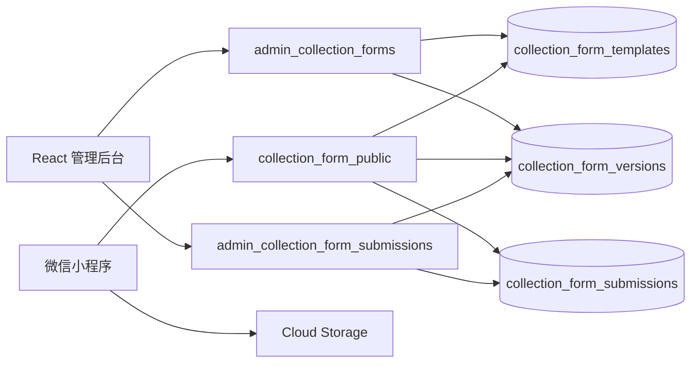

# 动态收集表技术设计

## Architecture

管理后台通过现有 CloudBase Web SDK 调用管理员云函数；小程序通过 `wx.cloud.callFunction` 获取模板和提交答案，通过 `wx.cloud.uploadFile` 持久化附件。数据库只允许云函数访问。

## Data Model

- `collection_form_templates`：文档 ID 固定为 `collection_form_template:{spaceType}`，包含 `draft`、`draftRevision`、`publishedVersion`、`publishedVersionId` 和审计字段。
- `collection_form_versions`：发布快照只增不改，包含 `schemaVersion=1`、版本号、完整模块与发布审计字段。
- `collection_form_submissions`：保存幂等请求 ID、模板版本、清洗答案、文件 ID、OPENID、可选用户快照和提交时间。

## Interfaces

- `admin_collection_forms`：`initialize/list/getDraft/saveDraft/publish/listVersions/getVersion`。
- `collection_form_public`：`getPublished/submit`。
- `admin_collection_form_submissions`：`list/get`。
- 所有接口统一返回 `{ success, code, data, errorMessage }`。

## Validation

- 稳定 ID 必须唯一；模块、问题和选项顺序决定展示编号。
- 条件来源必须在当前题之前；`equals` 只用于单选，`includes` 只用于多选。
- 服务端按版本快照重新计算可见题，丢弃隐藏题与未知题答案。
- 草稿序列化大小不超过 1 MB；发布要求至少一个模块且每个模块至少一题。
- 提交 ID 使用 OPENID 与客户端 `requestId` 的 SHA-256 摘要生成，保证幂等。

## Compatibility

- 未发布或请求失败时使用缓存，再回退至现有内置模板。
- 草稿保存模板快照；旧版草稿可继续提交。
- 旧 `lighting_collections`、旧记录页和灯具选型表不迁移。
- 本轮只生成部署说明，不修改线上数据库、云函数或托管内容。
