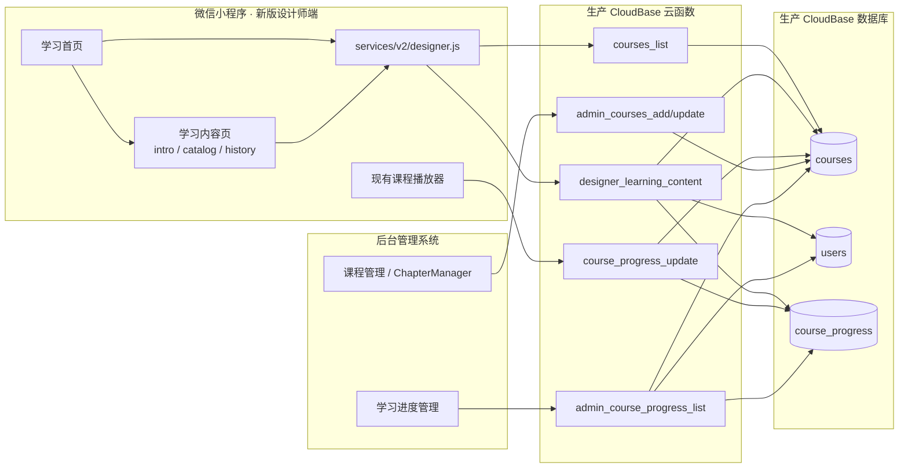
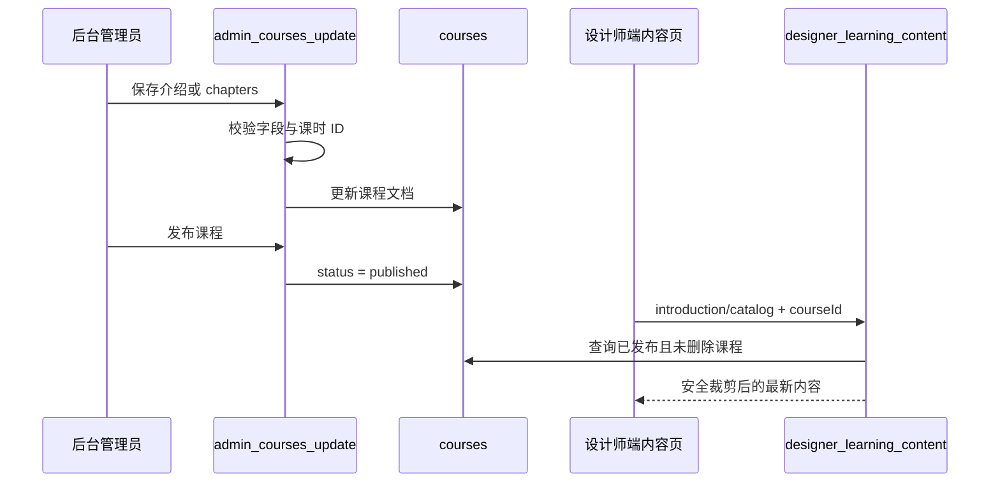
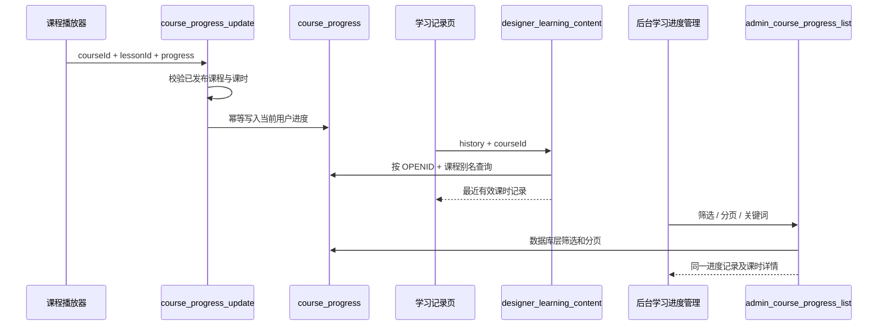

# 技术设计文档：设计师端学习页三个课程板块后端联调

## 1. 设计概述

本期围绕设计师端学习页的“课程介绍、课程目录、学习记录”三个入口，新增一个面向新版设计师端的只读内容云函数，并对现有课程保存、进度写入和后台进度查询链路做兼容性修复。

核心设计原则：

- 三个板块按需加载，不扩大为学习首页聚合接口。
- 后台课程管理是课程介绍和目录的唯一内容来源。
- `course_progress` 是小程序学习记录和后台进度管理的唯一事实来源。
- 公开目录仅返回元数据，视频、附件和网盘信息继续由现有受保护接口控制。
- 新版页面使用独立 V2 内容页，避免修改旧版课程详情页并影响正式版用户。
- 所有 CloudBase 初始化继续使用 `cloud.DYNAMIC_CURRENT_ENV`，不引入测试环境 ID。

## 2. 现状分析与设计决策

### 2.1 当前可复用能力

- `courses_list`：已发布课程列表，可供学习页确定当前课程 ID。
- `courses`：后台课程管理保存课程介绍、详情图片、章节和课时。
- `course_progress_update`：播放器写入整体进度、课时进度和最后课时。
- `admin_course_progress_list`：后台学习进度管理读取进度记录。
- 后台 `CourseList.tsx` 与 `ChapterManager.tsx`：已经具备介绍及目录编辑界面。
- 后台 `LearningProgress.tsx`：已经具备筛选、列表和详情界面。

### 2.2 已发现的联调缺口

1. 学习页三个入口目前都复用旧课程详情页，其中“学习记录”错误地等同于目录 Tab。
2. 现有 `course_detail` 同时承担旧版业务，而且当前格式化结果包含网盘字段，不适合直接作为新版三个板块的最小安全接口。
3. `course_progress_update` 会查询课程，但没有验证课程是否已发布，也没有拒绝不存在于目录中的课时 ID。
4. 新建进度采用“先查后加”，并发首次上报存在重复记录窗口。
5. `admin_course_progress_list` 只按 `users._openid` 关联用户，不兼容 `users.openid`。
6. 后台课程筛选代码读取 `res.data.courses`，而当前 `courses_list` 返回的 `data` 实际为数组。
7. 后台进度关键词是在分页后过滤，导致列表条数和 `total` 与筛选结果不一致。
8. 后台课程保存允许任意 `chapters` 结构进入已发布课程，缺少课时 ID 唯一性和必要字段校验。

### 2.3 关键决策

| 决策 | 选择 | 原因 |
| --- | --- | --- |
| 三个板块接口 | 新增 `designer_learning_content`，按 action 路由 | 不污染旧版 `course_detail`，返回面更小、更安全 |
| 页面承载方式 | 新增一个 V2 内容页，以 `section` 切换三种内容 | 减少三个页面的重复代码，不改变学习首页 UI |
| 当前课程选择 | 继续由学习首页调用 `courses_list({ limit: 1 })` | 符合已确认范围，不开发推荐课程聚合 |
| 目录资源 | 只返回公开元数据 | 视频和附件继续通过既有受保护接口获取 |
| 学习记录 | 从 `course_progress.lessonProgress` 动态映射当前目录 | 不新增集合，不复制课程标题快照 |
| 管理端联调 | 修复现有页面和云函数，不重构后台 UI | 控制本期范围和回归风险 |
| 历史字段 | 同时兼容文档 `_id`、`courseId`，以及 `_openid`、`openid` | 兼容生产历史数据，不做破坏性迁移 |

## 3. 系统架构



### 3.1 内容更新闭环



### 3.2 学习记录闭环



## 4. 云函数设计

### 4.1 新增 `designer_learning_content`

目录：

```text
cloudfunctions/designer_learning_content/
  index.js
  domain.js
  package.json
```

- `index.js`：CloudBase 上下文、数据库查询、临时 URL 转换、统一响应和日志。
- `domain.js`：纯函数，包括参数归一化、安全裁剪、目录构建、课时索引、进度归一化、历史记录排序；供 Node 自动化测试直接加载。
- `package.json`：沿用项目云函数的 `wx-server-sdk ~2.6.3`。

#### 4.1.1 请求

```js
{
  action: 'introduction' | 'catalog' | 'history',
  courseId: 'CO...' // 业务 courseId 或 courses._id
}
```

约束：

- `action` 必须在白名单中。
- `courseId` 必须是去除首尾空白后的字符串，长度为 1-128。
- 客户端传入的用户身份字段全部忽略。

#### 4.1.2 课程查询

`findPublishedCourse(courseId)` 按以下顺序执行：

1. 使用 `courses.courseId === courseId`、`status === 'published'`、`isDelete !== 1` 查询。
2. 未命中时使用 `courses.doc(courseId)` 查询，再在函数内验证 `status` 和 `isDelete`。
3. 始终只投影 action 所需字段，避免把整份课程文档读入返回对象。

响应区分：

- 两种 ID 均不存在：`COURSE_NOT_FOUND`。
- 文档存在但不是已发布可用状态：`COURSE_NOT_AVAILABLE`。

#### 4.1.3 `introduction` 动作

返回字段：

```js
{
  id,
  courseId,
  title,
  subtitle,
  description,
  coverUrl,
  detailImages,
  instructor: { name, avatarUrl },
  targetAudience,
  highlights,
  benefits
}
```

兼容规则：

- 封面：`cover || coverUrl || swiperImages[0] || ''`。
- 详情图：优先 `detailImages`，再兼容 `images`，最后兼容单值 `detailImage`。
- 讲师头像：`instructorAvatar || instructor.avatar || ''`。
- 数组字段仅保留字符串并去除空值；限制最大返回数量，详情图 20 张、亮点和收益各 20 条。
- 收集去重后的 `cloud://` 图片 ID，通过一次 `cloud.getTempFileURL` 批量转换。
- 不读取和不返回 `chapters`、视频字段、文件字段及所有 `drive*` 字段。

#### 4.1.4 `catalog` 动作

返回字段：

```js
{
  id,
  courseId,
  title,
  totalLessons,
  chapters: [
    {
      index,
      title,
      lessonCount,
      lessons: [
        { id, index, title, type, duration, format, questionCount, passScore }
      ]
    }
  ]
}
```

裁剪规则：

- 章节和课时保持后台数组顺序，`index` 为返回时生成的 1 基序号。
- 合法课时类型为 `video | file | quiz`。
- 课时必须具有唯一非空 `id` 和非空 `title`；不合法项跳过并写警告日志。
- `duration` 仅供显示；`format` 仅返回格式名称；作业课时返回 `questionCount` 和 `passScore`。
- 明确删除 `videoUrl`、`videoUrls`、`fileUrl`、`timeChapters`、`quizId` 等资源或内部关联字段。
- `totalLessons` 统计所有合法目录项；学习进度计算仍按现有可学习视频课时规则，二者字段含义分开。

#### 4.1.5 `history` 动作

处理顺序：

1. 从 CloudBase 上下文取得 `OPENID`。
2. 查询 `users`，兼容 `_openid` 与 `openid`；角色必须为 `0` 或 `2`。
3. 查询已发布课程并构建 `lessonId -> { lessonTitle, chapterTitle, type }` 索引。
4. 使用 `userId === OPENID` 且 `courseId` 命中业务 ID 或文档 ID 查询进度记录。
5. 如果历史上存在多条记录，选择 `updatedAt` 最新的一条返回并记录重复数据告警；本期不自动删除生产历史记录。
6. 遍历 `lessonProgress`，只保留能在当前目录索引中匹配的课时。
7. 将时间统一转换为毫秒时间戳，按 `lastWatchedAt` 降序，最多 20 条。

返回字段：

```js
{
  courseId,
  progress,
  totalLessons,
  completedCount,
  lastLessonId,
  lastWatchedAt,
  records: [
    {
      lessonId,
      lessonTitle,
      chapterTitle,
      progress,
      isCompleted,
      lastWatchedAt
    }
  ]
}
```

归一化规则：

- 进度使用 `clamp(round(number), 0, 100)`。
- 完成课时以当前有效目录与 `isCompleted === true` 为准，避免历史悬空 ID 增加计数。
- `lastLessonId` 只有在当前目录仍存在时才返回，否则为空。
- 无进度记录返回 0 值和空数组，仍为成功响应。

### 4.2 修改 `course_progress_update`

保留现有请求和响应主结构，增加以下行为：

1. 课程查询同时兼容业务 `courseId` 和文档 `_id`。
2. 课程必须 `status === 'published'` 且 `isDelete !== 1`。
3. 只允许目录中真实存在且类型为 `video` 的课时写入视频进度；无效课时返回 `LESSON_NOT_FOUND`。
4. `lessonProgress` 输入先转为有限数字，再限制到 `0-100`。
5. `action` 只允许 `update | complete`。
6. 已完成课时保持 `progress: 100`，后续较小进度不会回退完成状态。
7. 新记录使用 `sha256(OPENID + ':' + canonicalCourseId)` 生成稳定文档 ID，采用 `doc(id).set` 避免并发首次上报生成多条新记录。
8. 发现历史记录时继续更新最新历史文档，保持生产数据兼容；新建记录统一存储课程业务 `courseId`。
9. 完成列表只保留当前课程仍存在的视频课时 ID，避免已删除课时影响整体进度。

### 4.3 修改 `admin_courses_add` / `admin_courses_update`

新增相同的课程内容校验函数：

```js
validateCourseContent(course, { publishing: boolean })
```

校验内容：

- `detailImages`、`images`、`benefits`、`highlights` 必须为限制长度的数组。
- `chapters` 必须为数组，章节标题必须为字符串，`lessons` 必须为数组。
- 每个课时必须包含 `id`、`title` 和合法 `type`。
- 同一课程中课时 ID 全局唯一。
- `passScore` 限制在 `0-100`，`questionCount` 为非负整数。
- 发布课程时执行严格校验；保存草稿时允许空章节，但不允许结构类型错误。

更新课程时先读取旧文档并与本次 `data` 合并，再根据合并后的目标状态校验，解决“只提交 status=published 时未校验旧 chapters”的问题。

普通编辑不重新生成课时 ID；ID 由后台 `ChapterManager` 仅在新增课时时生成。

### 4.4 修改 `admin_course_progress_list`

#### 鉴权

- 引入与其他后台课程云函数一致的 `admin_auth.js`。
- 优先验证后台 `_adminToken`，再兼容微信上下文管理员身份。
- 返回稳定错误码，不把管理员 Token 写入日志。

#### 查询与关联

- 对 `limit`、`offset`、`orderBy`、`order` 做白名单和边界校验。
- `orderBy` 只允许 `updatedAt | createdAt | progress`。
- 课程筛选同时兼容进度记录中的业务 `courseId` 和课程文档 `_id`。
- 用户关联并行查询 `_openid in userIds` 和 `openid in userIds` 后合并。
- 课程关联并行查询 `courseId in courseIds` 和 `_id in courseIds` 后合并，并以两个 ID 建立别名映射。
- 关键词先在用户昵称和课程名称中解析匹配 ID，再将条件应用到 `course_progress` 查询；`count` 和分页在过滤后执行，避免当前“分页后前端内存过滤”导致总数错误。
- 课时明细复用安全目录索引，只返回标题、进度和时间，不返回资源字段。

### 4.5 统一错误码

| 错误码 | 场景 |
| --- | --- |
| `INVALID_ACTION` | 不支持的 action |
| `INVALID_PARAMS` | courseId、分页、排序或内容结构不合法 |
| `UNAUTHENTICATED` | 小程序学习记录缺少 OPENID |
| `NOT_DESIGNER` | 当前用户不是设计师/管理员 |
| `FORBIDDEN` | 后台管理员鉴权失败 |
| `COURSE_NOT_FOUND` | 两种课程 ID 均不存在 |
| `COURSE_NOT_AVAILABLE` | 课程未发布、下架或删除 |
| `LESSON_NOT_FOUND` | 进度上报的课时不在当前发布课程中 |
| `INTERNAL_ERROR` | 未分类服务端异常 |

对外错误信息使用中文；详细异常仅进入云函数日志。

## 5. 小程序端设计

### 5.1 V2 服务层

修改 `services/v2/designer.js`，增加：

```js
learningIntroduction(courseId)
learningCatalog(courseId)
learningHistory(courseId)
```

三个方法统一通过 `callCloud('designer_learning_content', ...)` 调用，页面代码不直接使用 `wx.cloud`。

### 5.2 学习首页入口

修改 `pages/v2/designer-learning/index.js`：

- 保留当前 `courses_list({ limit: 1 })` 和首页视觉数据。
- 将三个入口分别映射为：
  - `intro` -> `section=intro`
  - `catalog` -> `section=catalog`
  - `history` -> `section=history`
- 跳转地址：

```text
/pages/v2/designer-learning-content/index
  ?courseId={encodedCourseId}
  &section={intro|catalog|history}
```

- `startLearning` 继续沿用现有课程详情/播放入口，本期不修改。

### 5.3 新增学习内容页

```text
pages/v2/designer-learning-content/
  index.js
  index.wxml
  index.wxss
  index.json
```

设计约束：

- 页面是普通子页面，不加入底部 Tab。
- 使用微信系统导航栏和系统返回键，不绘制重复自定义标题栏。
- `section` 决定导航标题和内容模板。
- 只复用当前 V2 黑白色彩、圆角、分割线、字号和空状态风格，不改变学习首页布局。
- 页面状态统一为 `loading | ready | empty | error`，错误态提供“重新加载”。
- 课程介绍显示文字与图片；目录显示章节折叠列表；学习记录显示总体进度和按时间倒序的课时记录。
- 点击目录课时或历史记录时，仍进入现有受保护课程学习入口；若现有播放器路由不支持直接定位，则携带 `lessonId` 到现有课程详情目录，由既有链路处理。

### 5.4 分包注册

在 `app.json` 的 `pages/v2/` 分包中增加：

```json
"designer-learning-content/index"
```

不修改正式版 tabBar 和旧版页面注册。

## 6. 后台管理系统设计

### 6.1 课程管理联调

`CourseList.tsx` 保持现有 UI：

- 保存课程介绍字段时继续调用 `courseApi.add/update`。
- `ChapterManager` 继续回填 `chapters`。
- 前端在提交前增加与服务端一致的基础校验提示，但最终以云函数校验为准。
- 云函数返回 `INVALID_PARAMS` 时展示具体中文字段错误。
- 保存成功后重新请求课程列表，确认后台显示的是服务端持久化结果。

### 6.2 学习进度管理联调

修改 `LearningProgress.tsx`：

- 课程筛选兼容 `courses_list` 的实际 `data: Course[]`，同时保留对历史 `{ courses: [] }` 响应的兼容。
- 搜索、课程筛选或 pageSize 变化时回到第一页并仅发起一次列表请求。
- `total` 使用服务端过滤后的总数。
- 详情列表按 `lastWatchedAt` 降序展示有效课时。
- 用户/课程缺失时使用服务端占位文本，不在前端推断敏感数据。

### 6.3 管理端类型

必要时更新 `src/types/index.ts`：

- 明确课程介绍兼容字段。
- 为后台进度接口增加实际响应类型。
- 不修改无关业务类型。

## 7. 数据模型

本期不新增集合。

### 7.1 `courses`

```js
{
  _id: string,
  courseId: string,
  title: string,
  subtitle: string,
  description: string,
  cover: string,
  instructorName: string,
  instructorAvatar: string,
  detailImages: string[],
  images: string[],              // 历史兼容
  detailImage: string,           // 历史兼容
  targetAudience: string,
  highlights: string[],
  benefits: string[],
  chapters: [
    {
      title: string,
      lessons: [
        {
          id: string,
          title: string,
          type: 'video' | 'file' | 'quiz',
          duration?: string,
          videoUrl?: string,
          videoUrls?: object,
          fileUrl?: string,
          format?: string,
          quizId?: string,
          questionCount?: number,
          passScore?: number
        }
      ]
    }
  ],
  status: 'draft' | 'published' | 'offline',
  isDelete: number,
  updatedAt: number
}
```

### 7.2 `course_progress`

```js
{
  _id: string,
  userId: string,                // OPENID
  courseId: string,              // 规范化后的业务 courseId
  progress: number,
  completedLessons: string[],
  lessonProgress: {
    [lessonId]: {
      progress: number,
      isCompleted: boolean,
      lastWatchedAt: Date
    }
  },
  totalLessons: number,
  lastLessonId: string,
  lastLessonProgress: number,
  createdAt: Date,
  updatedAt: Date
}
```

### 7.3 索引要求

联调前只读检查以下索引；缺失时形成生产部署清单，不在代码运行时创建：

- `course_progress`: `userId + courseId`
- `course_progress`: `courseId + updatedAt`
- `course_progress`: `updatedAt`
- `courses`: `courseId`
- `courses`: `status + isDelete`

## 8. 安全设计

- 身份来源只使用可信云函数上下文或后台现有管理员 Token。
- 所有 action、ID、分页和排序字段采用白名单验证。
- `introduction` 使用显式允许字段投影；`catalog` 使用显式重建对象，禁止返回原始 lesson。
- 资源字段采用 deny-list 二次断言测试，确保 `videoUrl`、`videoUrls`、`fileUrl`、`drivePassword` 等不会出现在序列化响应中。
- 学习记录以 `OPENID` 强制约束，不提供查询任意 userId 的小程序 action。
- 日志中的 OPENID 使用哈希或截断标识，不输出完整 Token、资源地址和密码。
- 后台课程发布采用服务端结构校验，不能只依赖 React 表单。

## 9. 性能与降级

- 三个板块按用户点击懒加载，首页不额外增加三次请求。
- 课程介绍图片临时 URL 一次批量转换并去重。
- 单门课程目录在一个课程文档内读取，不产生逐章节查询。
- 学习记录只读取当前用户当前课程的一条最新进度，最多返回 20 条。
- 后台进度列表对用户和课程关联使用批量查询，禁止逐行 N+1 查询。
- 图片临时 URL 转换失败时保留空地址并返回文字内容，不令整页失败；数据库主查询失败则返回 `INTERNAL_ERROR`。

## 10. 测试设计

### 10.1 纯函数单元测试

新增 `specs/designer-learning-backend.test.js`，覆盖：

- 介绍字段兼容与数组限制。
- 云文件 ID 收集和 URL 替换。
- 目录顺序、序号和空目录。
- 非法/重复课时 ID 过滤与发布校验。
- 视频、附件和网盘字段不出现在结果中。
- 进度 clamp、时间转换、最近记录排序与 20 条限制。
- 悬空课时过滤和完成数量重算。

### 10.2 云函数契约测试

通过依赖注入或 VM mock CloudBase SDK，覆盖：

- 三种 action 与非法 action。
- 业务 `courseId`、文档 `_id`、不存在和不可用课程。
- `history` 未登录、非设计师、无记录和用户隔离。
- `course_progress_update` 无效课时、完成不回退和稳定新记录 ID。
- 后台管理员 Token、微信管理员和无权限请求。
- 后台关键词过滤后的 `total` 与分页一致。

### 10.3 小程序页面测试

扩展 `specs/designer-learning-preview.test.js` 并新增内容页测试：

- 三个入口生成不同 `section`。
- 无课程时阻止跳转并显示中文提示。
- 内容页不直接调用 `wx.cloud`。
- 加载、空、错误和重试状态存在。
- 使用系统导航栏，不出现自定义返回键。
- V2 页面不修改旧版页面文件。

### 10.4 后台测试

- 运行 `npm run build` 验证 TypeScript 和 Vite 构建。
- 针对课程列表响应兼容和筛选参数增加可测试的纯函数，或通过现有测试框架验证。
- 手工联调矩阵：

| 后台操作 | 小程序验证 | 后台进度验证 |
| --- | --- | --- |
| 修改介绍并发布 | 课程介绍显示新内容 | 不受影响 |
| 调整章节/课时顺序 | 课程目录顺序一致 | 课时标题映射一致 |
| 播放并上报进度 | 学习记录立即更新 | 列表和详情可见 |
| 删除历史课时 | 目录不显示 | 悬空记录不作为可点击项 |
| 下架课程 | 三个板块返回不可用 | 历史后台记录仍可审计 |

### 10.5 回归测试

- 项目现有课程、V2 路由、V2 渠道门禁和页面预览测试全部通过。
- 正式版旧 UI 相关文件哈希/快照测试保持通过。
- 不调用测试环境，不执行生产部署。

## 11. 变更文件清单

### 新增

```text
cloudfunctions/designer_learning_content/index.js
cloudfunctions/designer_learning_content/domain.js
cloudfunctions/designer_learning_content/package.json
pages/v2/designer-learning-content/index.js
pages/v2/designer-learning-content/index.wxml
pages/v2/designer-learning-content/index.wxss
pages/v2/designer-learning-content/index.json
specs/designer-learning-backend.test.js
specs/designer-learning-content-preview.test.js
```

### 修改

```text
app.json
services/v2/designer.js
pages/v2/designer-learning/index.js
cloudfunctions/course_progress_update/index.js
cloudfunctions/admin_courses_add/index.js
cloudfunctions/admin_courses_update/index.js
cloudfunctions/admin_course_progress_list/index.js
cloudfunctions/admin_course_progress_list/admin_auth.js
Backend-management/guangyi-admin/src/pages/content/CourseList.tsx
Backend-management/guangyi-admin/src/pages/content/LearningProgress.tsx
Backend-management/guangyi-admin/src/types/index.ts（仅必要时）
specs/designer-learning-preview.test.js
```

## 12. 生产联调与部署边界

本阶段和后续本地开发不自动部署。代码完成并通过测试后，生产联调按以下顺序执行，且每次部署均需用户明确授权：

1. 只读核对生产集合字段和索引。
2. 部署新的 `designer_learning_content`。
3. 部署修复后的 `course_progress_update`、`admin_courses_add`、`admin_courses_update`、`admin_course_progress_list`。
4. 使用后台保存一门现有课程的介绍和目录，不创建测试环境或测试数据库。
5. 使用开发版/体验版新版 UI 验证三个板块。
6. 后台验证同一用户的学习记录。
7. 确认旧版正式版 UI 和课程链路未变化后，再进行小程序代码提审或发布。

