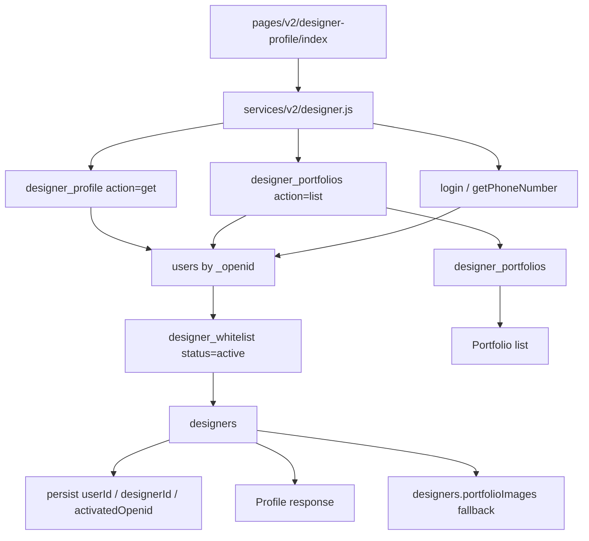

# Technical Design

## Overview

本次改造复用现有后台管理系统的数据集合：

- `designer_whitelist`: 设计师认证准入，以 `status = active` 为唯一开放条件。
- `designers`: 后台设计师管理维护的真实档案。
- `designer_portfolios`: 设计师作品集集合。

小程序 V2「我的」页继续通过 `services/v2/designer.js` 调用云函数，不直接访问数据库。云函数使用 `cloud.getWXContext().OPENID` 获取真实调用身份，不信任客户端传入的 openid、phone、designerId。

## Cloud Function Design

### Shared Access Logic

Both `designer_profile` and `designer_portfolios` implement equivalent local helper logic:

1. Read current user from `users` by server-side OPENID.
2. Match active whitelist by:
   - `openid/_openid/activatedOpenid/userOpenid/designerOpenid`
   - normalized user phone variants against `phone/purePhoneNumber/fullPhoneNumber`
3. Prefer whitelist `designerId` to read `designers`.
4. Fallback to `designers` matching by `openid/_openid/userId/phone`.
5. If a designer doc is missing but whitelist is active, initialize a minimal `designers` record from `users` and whitelist data.

### Shared Account And Identity

`users` remains the only login account collection for both owner and designer experiences. `designers` stores professional profile data and must never be used as a second login account.

Identity lookup order:

1. Server-side `OPENID` against `users._openid/openid/alternateOpenids`.
2. Server-side `UNIONID` against `users.unionId` when available.
3. Never use a client supplied `userId`, `openid`, phone, or `designerId` to choose the authenticated account.

The numeric `users.roles` field remains compatible with the existing project: certified designers use role `2` (admins remain `0`), while owner V2 APIs continue to use the same user record and server-side identity. The client may switch its active experience without creating another account.

### Certification Binding

An active designer whitelist match creates or repairs these links idempotently:

- `users.designerId`, `users.designerWhitelistId`, `users.designerCertified`
- `designer_whitelist.userId`, `designer_whitelist.designerId`, `designer_whitelist.activatedOpenid`, `designer_whitelist.activatedAt`
- `designers.userId`, `designers.whitelistId`, `designers.openid/_openid`

The binding runs after trusted phone authorization and when an existing shared account enters the designer profile flow. Removing a whitelist record revokes the designer role/certification markers but preserves the owner account profile.

### `designer_profile`

Actions:

- `get`: returns normalized designer profile for V2 page.
- `update`: updates whitelisted profile fields and syncs basic `users.nickname/avatarUrl`.

Important response fields:

- `name/nickname`
- `profession/specialty`
- `intro/bio`
- `avatarUrl/tempAvatarUrl`
- `certified/certificationStatus`
- `stats.projects/rating/experience/portfolioCount`

### `designer_portfolios`

Actions:

- `list`: returns real portfolio records from `designer_portfolios`.
- `add`: validates and inserts real portfolio records.
- `delete`: soft deletes owned portfolio records.

Fallback rule:

If `designer_portfolios` has zero records, the function may adapt `designers.portfolioImages` into read-only list items because that field is maintained by the current backend designer management UI. If both sources are empty, the function returns an empty list.

## Frontend Design

V2「我的」页 keeps the current visual style and bottom tabbar. Data behavior changes:

- Remove local `WORKS` mock constant.
- Render `works` only from cloud response.
- Filter works without image URL.
- Show `copy.emptyWorks` empty state when there are no real works.

No new large UI state is introduced because this request targets backend integration and mock removal.

## Admin Integration

Backend management already uses:

- `admin_designers_list/add/update` for `designers`
- `admin_designer_whitelist_list/import/remove` for `designer_whitelist`

The mini-program functions read those same collections. The whitelist list response additionally exposes account binding state and activation time so the admin UI can verify the integration. Import reactivates disabled duplicates, and remove revokes linked designer permissions.

## Test Strategy

1. `specs/designer-profile-backend.test.js`
   - active whitelist returns real profile data
   - inactive/missing whitelist denies before designer query
   - portfolio records return real data with temp URLs
   - `designers.portfolioImages` fallback works
   - empty backend portfolio data remains empty
2. `specs/designer-profile-preview.test.js`
   - V2 page remains registered
   - static mock works are removed
   - empty works state exists
3. Syntax checks:
   - `node --check cloudfunctions/designer_profile/index.js`
   - `node --check cloudfunctions/designer_portfolios/index.js`
4. Full regression:
   - `npm.cmd test`
   - `npm.cmd run check:app-pages`
5. Shared identity and binding contracts:
   - existing owner user is reused by `OPENID/UNIONID/alternateOpenids`
   - client supplied user id is ignored
   - active whitelist links user, whitelist, and designer records
   - whitelist removal revokes only designer access

## Deployment

Deploy after tests:

- `designer_profile`
- `designer_portfolios`
- `login`
- `getPhoneNumber`
- `check_designer_whitelist`
- `admin_designer_whitelist_list`
- `admin_designer_whitelist_import`
- `admin_designer_whitelist_remove`

Both functions use `cloud.DYNAMIC_CURRENT_ENV`, so deployment follows the active CloudBase environment configured in `cloudbaserc.json`.
