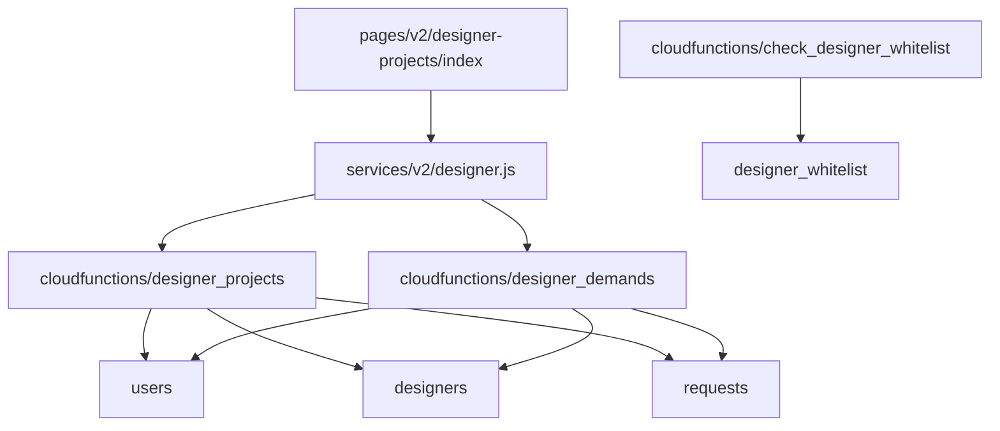
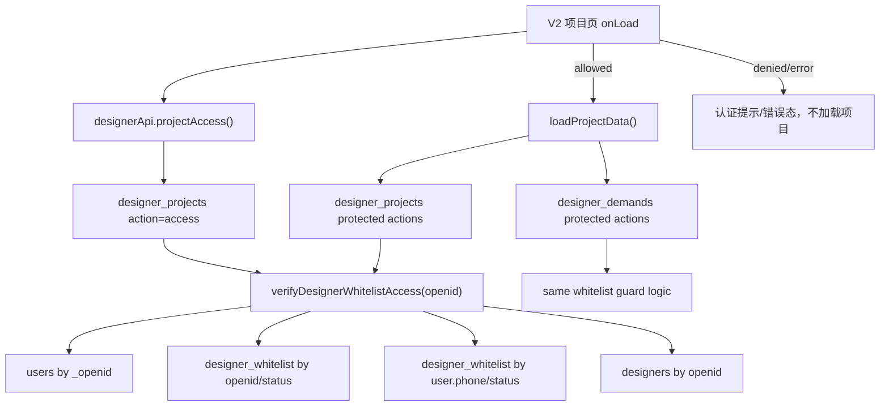

# Technical Design

## Overview

设计师端项目页准入要同时覆盖用户体验和后端安全边界。方案采用双层校验：

1. 前端 `pages/v2/designer-projects/index` 进入页面后先调用设计师项目权限检查。
2. 云函数 `designer_projects` 与 `designer_demands` 在所有受保护 action 执行前强制校验当前 OPENID 是否命中后台 `designer_whitelist` 启用记录。

前端校验用于避免未认证用户看到项目内容；后端校验用于防止绕过前端直接调用云函数。白名单数据继续复用后台管理系统现有 `designer_whitelist` 集合，不新增认证集合。

## Current Architecture



Observed behavior:

- `designer_projects` supports `list / detail / update_step / submit_verify`.
- `designer_demands` supports `list / detail / accept / collect / uncollect / check_collect / count`.
- Both cloud functions currently verify `users.roles` and designer profile existence, but they do not enforce `designer_whitelist` on every request.
- The V2 project page loads `designerApi.projects(...)` and `designerApi.demands(...)` in parallel during `loadProjectData()`.

## Target Architecture



## Data Model

### Existing Collection: `designer_whitelist`

The implementation will reuse fields already implied by the admin whitelist and `check_designer_whitelist` flow:

| Field | Usage |
| --- | --- |
| `phone` | Primary backend-managed whitelist key. Matched with normalized user phone variants. |
| `status` | Only `active` records grant access. Disabled/removed records deny access. |
| `openid` / `_openid` / `activatedOpenid` | Optional binding fields for activated records. Used when present. |
| `name` / `remark` | Display/admin metadata only; not required for access. |

### Existing Collection: `users`

| Field | Usage |
| --- | --- |
| `_openid` | Server-side identity lookup. |
| `phone` / `phoneNumber` | Fallback whitelist matching when whitelist record is not bound by OPENID. |
| `roles` | Still used as a coarse role check, but it is no longer sufficient for project access. |

### Existing Collection: `designers`

Still required for project ownership and accepted project operations. Whitelist access proves certification; `designers` profile provides `designer._id`.

## Cloud Function Design

### Shared Guard Contract

Each protected cloud function will add a local helper because CloudBase cloud functions are deployed independently.

```js
async function verifyDesignerWhitelistAccess(openid) {
  // returns { user, designer, whitelist }
  // throws USER_NOT_FOUND / DESIGNER_NOT_CERTIFIED / NOT_DESIGNER_PROFILE
}
```

Guard behavior:

1. Read `users` by server-side `openid`.
2. Query `designer_whitelist` for enabled records using:
   - OPENID binding fields when available.
   - User phone variants using the same phone normalization strategy as `check_designer_whitelist`.
3. Require `status === 'active'`.
4. Require a matching `designers` profile for operations that need `designer._id`.
5. Do not trust client-provided `openid`, `phone`, `userId`, or `designerId`.

### `designer_projects`

Add `action: 'access'`.

Request:

```js
{ action: 'access' }
```

Success response:

```js
{
  success: true,
  code: 'OK',
  data: {
    allowed: true,
    designerId: '...',
    certified: true
  }
}
```

Denied response:

```js
{
  success: false,
  code: 'DESIGNER_NOT_CERTIFIED',
  message: '请先完成平台设计师认证后再使用项目功能',
  data: { allowed: false }
}
```

Protected actions:

- `list`
- `detail`
- `update_step`
- `submit_verify`

These actions will call the same whitelist guard before project-specific logic.

### `designer_demands`

Protected actions:

- `list`
- `detail`
- `accept`
- `collect`
- `uncollect`
- `check_collect`
- `count`

`list` and `count` are protected because the whole接单大厅 is not available to uncertified designers. `accept` remains protected before any request mutation.

## Frontend Design

### Service Layer

Extend `services/v2/designer.js`:

```js
projectAccess: () => callCloud('designer_projects', { action: 'access' })
```

### Page State

Add state to `pages/v2/designer-projects/index.js`:

```js
projectAccessStatus: 'checking' | 'allowed' | 'denied' | 'error',
projectAccessMessage: ''
```

`onLoad()` flow changes from:

```js
this.setData(getLayout())
this.loadProjectData()
```

to:

```js
this.setData(getLayout())
this.checkProjectAccess()
```

`checkProjectAccess()`:

1. Set `projectAccessStatus = 'checking'`.
2. Call `designerApi.projectAccess()`.
3. If allowed, set `allowed` and call `loadProjectData()`.
4. If denied, set `denied`, clear project arrays, and do not call `loadProjectData()`.
5. If service error, set `error`, clear project arrays, and expose retry.

### WXML State

Keep the native custom header and bottom tab bar visible. Gate only the project content area.

State rendering:

- `checking`: show a white card with loading text.
- `denied`: show certification-required card.
- `error`: show retryable error card.
- `allowed`: render existing category tabs, marketplace, project list, completed list.

No new design system is introduced. Use current V2 visual language:

- Background `#f5f5f5`
- White cards
- Black primary text
- Grey secondary text
- Thin borders
- Current bottom tab bar

## Security Considerations

- Fail closed: frontend does not load projects when access check fails or times out.
- Server authority: backend uses `cloud.getWXContext().OPENID`.
- Role is not enough: `roles=2` without active whitelist is denied.
- Backend protects reads and mutations, not only UI.
- Disabled/deleted whitelist records take effect on the next access check.
- Sensitive project/contact fields remain governed by existing field filtering.

## Error Codes

| Code | Meaning | Frontend Behavior |
| --- | --- | --- |
| `OK` | Certified designer | Load project data |
| `DESIGNER_NOT_CERTIFIED` | Not in active whitelist | Show certification-required page |
| `NOT_DESIGNER_PROFILE` | Whitelist exists but designer profile missing | Show certification/profile setup message |
| `USER_NOT_FOUND` | No current user record | Show retry/login-related error |
| `AUTH_FAILED` | Missing OPENID | Show retryable error |
| `SERVER_ERROR` | Unexpected backend error | Show retryable error, no data |

## Test Strategy

### Frontend Preview Tests

Update `specs/designer-projects-preview.test.js`:

1. Verify `designerApi.projectAccess` is called before project/demand list calls.
2. Verify denied access prevents `projects` and `demands` calls.
3. Verify allowed access preserves existing project loading behavior.
4. Verify denied/error state text and retry binding exist in WXML.

### Backend Contract Tests

Add a focused domain/helper test, avoiding real CloudBase network:

1. Extract whitelist matching into a pure helper where practical, or test cloudfunction source contracts.
2. Verify active whitelist by OPENID allows access.
3. Verify active whitelist by phone allows access.
4. Verify missing/disabled whitelist rejects access.
5. Verify protected action switches call the guard.

### Manual Verification

1. Use a phone in backend designer whitelist with `status=active`: V2 项目页 loads normally.
2. Disable/remove that whitelist record: reopen V2 项目页; page shows certification-required state and no project cards.
3. Call `designer_demands accept` as the disabled user: backend rejects before mutation.
4. Re-enable whitelist: project page access recovers.

## Rollout Notes

- This change affects V2 designer project page and relevant cloud functions.
- Existing legacy `pages/designer-projects` production page remains unchanged unless a later task explicitly includes it.
- Cloud functions to deploy after implementation:
  - `designer_projects`
  - `designer_demands`
- No database migration is required.
