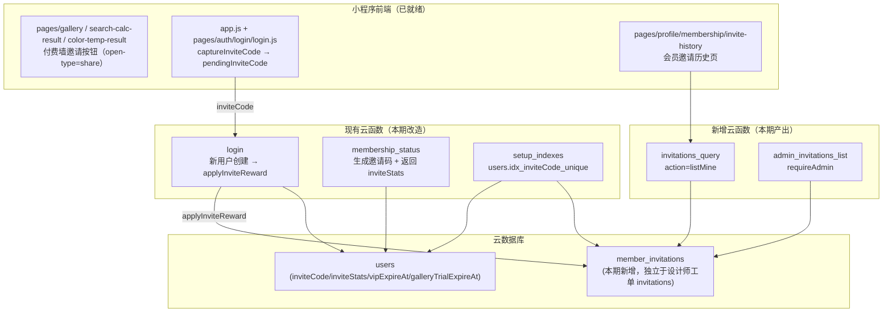
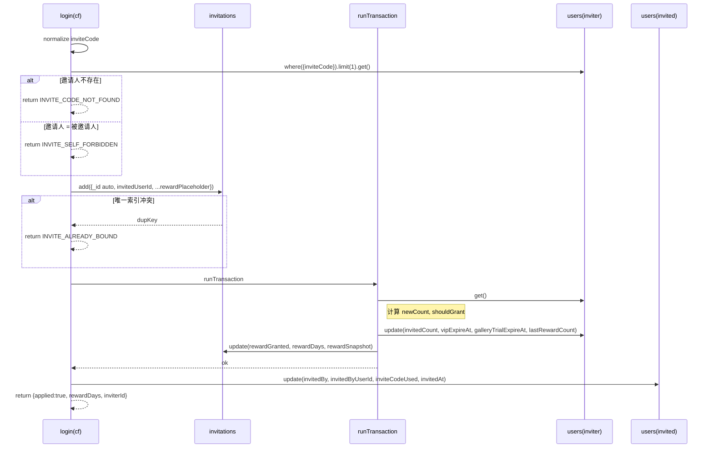
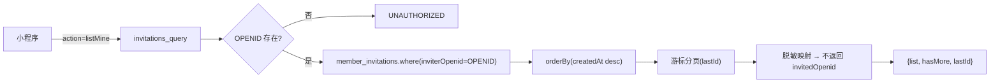
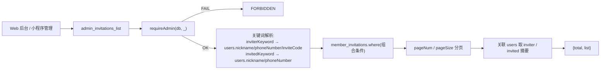
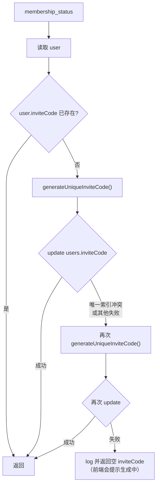

# 邀请好友机制后端技术设计文档（invite_reward_backend）

> 配套需求：`specs/invite_reward_backend/requirements.md`
>
> 范围：仅设计后端云函数与数据库改造；前端付费墙、分享面板、邀请历史 UI 已就绪，仅需消费新接口。

---

## 1. 架构总览

### 1.1 系统拓扑



### 1.2 设计原则

1. **向后兼容**：`login` / `membership_status` 的对外契约不变；现有 `inviteStats.invitedCount` 字段保留
2. **可幂等**：通过 `member_invitations.invitedUserId` 唯一索引保证 1 个被邀请人最多对应 1 条邀请记录
3. **可并发**：邀请人 `inviteStats` 更新与奖励发放使用 `db.runTransaction` 事务保证原子性
4. **可审计**：每条邀请记录保存奖励快照（`rewardSnapshot`），客服争议有据可查
5. **最小复用**：管理员鉴权直接复用 `cloudfunctions/admin_users_list/admin_auth.js` 同款 `requireAdmin(db, _)`，不新建鉴权方案
6. **错误不影响主流程**：邀请奖励失败时，`login` 仍返回 `success: true`，仅在 `inviteReward.code` 中体现失败原因

---

## 2. 数据模型

### 2.1 `users` 集合（保持现状，无新增字段）

| 字段 | 类型 | 说明 |
|---|---|---|
| `inviteCode` | string | 6 位字母数字，全局唯一（`idx_inviteCode_unique`） |
| `inviteStats.invitedCount` | number | 已邀请新用户数（累计，原子自增） |
| `inviteStats.trialDaysGranted` | number | 累计获得的试用天数（每次发奖 +7） |
| `inviteStats.lastRewardCount` | number | **本期新增内嵌字段**：上一次发奖时的 `invitedCount`，用于事务内判断"本次是否跨过奖励阈值" |
| `invitedBy` | string | 被邀请时记录邀请人 openid |
| `invitedByUserId` | string | 被邀请时记录邀请人 _id |
| `inviteCodeUsed` | string | 使用的邀请码 |
| `invitedAt` | number | 被邀请时间戳 |
| `vipExpireAt` | number | 会员到期（叠加奖励） |
| `galleryTrialExpireAt` | number | 图库试用到期（叠加奖励） |

> `inviteStats.lastRewardCount` 是嵌套字段，无需 schema 迁移；首次进入事务时用 `stats.lastRewardCount || 0` 兼容旧文档。

### 2.2 `member_invitations` 集合（本期新增）

> 集合名采用 `member_invitations` 而非 `invitations`，是为了避免与现有设计师邀请工单系统（`invitations_create` / `invitations_operations`）使用的 `invitations` 集合语义冲突。两者字段、索引、业务含义完全不同，互不影响。

```jsonc
{
  "_id": "invitations_xxx",
  "inviterUserId":  "users-A-id",
  "inviterOpenid":  "oA",
  "inviteCode":     "AB23CD",       // 写入时快照（邀请人当时的邀请码）
  "invitedUserId":  "users-B-id",   // 唯一索引 idx_invitedUserId_unique
  "invitedOpenid":  "oB",
  "invitedNickname":"昵称B",        // 写入时快照（best-effort）
  "invitedAvatarUrl":"https://...", // 写入时快照
  "createdAt":      1746631200000,

  "rewardGranted":  true,           // 是否在本次邀请中触发了奖励
  "rewardDays":     7,
  "rewardSnapshot": {
    "beforeInvitedCount":         5,
    "afterInvitedCount":          6,
    "beforeVipExpireAt":          1746000000000,
    "afterVipExpireAt":           1746604800000,
    "beforeGalleryTrialExpireAt": 0,
    "afterGalleryTrialExpireAt":  1746604800000
  },

  "errorCode":      ""              // 极端情况下落库的错误码（默认空）
}
```

### 2.3 索引

| 集合 | 索引名 | 字段 | 唯一 | 说明 |
|---|---|---|---|---|
| `users` | `idx_inviteCode_unique` | `inviteCode` ASC | ✅ | 已存在，本期补部署确认 |
| `member_invitations` | `idx_invitedUserId_unique` | `invitedUserId` ASC | ✅ | 本期新增，保证幂等 |
| `member_invitations` | `idx_inviter_createdAt` | `inviterUserId` ASC, `createdAt` DESC | ❌ | 本期新增，加速 `listMine` 与后台筛选 |
| `member_invitations` | `idx_createdAt_desc` | `createdAt` DESC | ❌ | 本期新增，后台按时间筛选 |

> 全部在 `cloudfunctions/setup_indexes/index.js` 声明，部署后由微信开放平台 `databaseupdateindex` 接口生效。

---

## 3. 核心流程

### 3.1 邀请奖励发放（重构后的 `applyInviteReward`）



**关键算法**

```js
// 在事务内执行
const stats = inviter.inviteStats || { invitedCount: 0, trialDaysGranted: 0, lastRewardCount: 0 }
const beforeCount = Number(stats.invitedCount) || 0
const beforeLastReward = Number(stats.lastRewardCount) || 0
const newCount = beforeCount + 1

const REWARD_EVERY = 2
const REWARD_DAYS = 7
// 用 lastRewardCount 而非 beforeCount 计算阈值，保证即使有并发漏算也能在下次补发
const shouldGrant = Math.floor(newCount / REWARD_EVERY) > Math.floor(beforeLastReward / REWARD_EVERY)

const updateInviter = {
  'inviteStats.invitedCount': newCount,
  updatedAt: now
}

if (shouldGrant) {
  const beforeVipExpireAt = Number(inviter.vipExpireAt) || 0
  const beforeGalleryExpireAt = Number(inviter.galleryTrialExpireAt) || 0
  const vipBase = beforeVipExpireAt > now ? beforeVipExpireAt : now
  const galleryBase = beforeGalleryExpireAt > now ? beforeGalleryExpireAt : now

  updateInviter['inviteStats.trialDaysGranted'] = (Number(stats.trialDaysGranted) || 0) + REWARD_DAYS
  updateInviter['inviteStats.lastRewardCount'] = newCount
  updateInviter.vipExpireAt = vipBase + REWARD_DAYS * ONE_DAY_MS
  updateInviter.galleryTrialExpireAt = galleryBase + REWARD_DAYS * ONE_DAY_MS
  updateInviter.vipUpdatedAt = now
  // 等级保护：仅未过期的 premium 保持 premium，否则降到 normal（普通会员试用）
  if (!(inviter.vipLevel === 'premium' && beforeVipExpireAt > now)) {
    updateInviter.vipLevel = 'normal'
  }
}

// 事务内同时更新两条记录（users.inviter + invitations）
```

**为什么用 `lastRewardCount` 而不是 `beforeCount`：**

如果用 `Math.floor(newCount/2) > Math.floor(beforeCount/2)` 判断阈值，事务的串行化保证了不会重复发奖，但万一未来引入"重置/补发"逻辑就不便。`lastRewardCount` 等于"最近一次成功发奖时的 invitedCount"，能直接回答"还有多少人没结算"，对客服与运营更友好。

### 3.2 `invitations_query`（用户侧）



参数：

```ts
{
  action: 'listMine',
  pageSize?: number,   // 默认 20，最大 50
  lastId?: string      // 上一页最后一条 _id，作为游标
}
```

返回：

```ts
{
  success: true,
  code: 'OK',
  data: {
    list: Array<{
      _id, invitedUserId, invitedNickname, invitedAvatarUrl,
      inviteCode, createdAt, rewardGranted, rewardDays
    }>,
    hasMore: boolean,
    lastId: string | null
  }
}
```

### 3.3 `admin_invitations_list`（后台侧）



参数：

```ts
{
  inviterKeyword?: string,
  invitedKeyword?: string,
  startAt?: number,           // ms
  endAt?: number,             // ms
  rewardGranted?: boolean,
  pageNum?: number,           // 默认 1
  pageSize?: number           // 默认 20，最大 100
}
```

返回项每条 `list[i]`：

```ts
{
  _id, createdAt, rewardGranted, rewardDays, inviteCode,
  inviter: { userId, openid, nickname, phoneNumber, avatarUrl, inviteCode },
  invited: { userId, openid, nickname, phoneNumber, avatarUrl }
}
```

### 3.4 `membership_status` 邀请码生成强化（最小改动）



> 现有 `membership_status` 已有这套兜底逻辑（应用层重试 5 次 + 时间戳兜底）；本期仅校验逻辑分支正确并对失败路径补日志前缀 `[membership_status][inviteCode]`，无需重写。

---

## 4. 错误码规范

| Code | 含义 | 出现位置 |
|---|---|---|
| `OK` | 正常 | 三个云函数 |
| `UNAUTHORIZED` | 未登录 | `invitations_query` |
| `FORBIDDEN` | 非管理员 | `admin_invitations_list` |
| `INVALID_PARAMS` | 参数缺失或非法 | 三个云函数 |
| `INVITE_CODE_NOT_FOUND` | 邀请码无对应用户 | `applyInviteReward` |
| `INVITE_SELF_FORBIDDEN` | 自邀 | `applyInviteReward` |
| `INVITE_ALREADY_BOUND` | 该用户已被邀请过（唯一索引冲突） | `applyInviteReward` |
| `INVITE_INVITER_GONE` | 邀请人在事务执行时已被删除 | `applyInviteReward` |
| `INVITE_REWARD_FAILED` | 事务失败、网络异常等内部错误 | `applyInviteReward` |
| `SERVER_ERROR` | 通用兜底 | 三个云函数 |

`login` 返回结构（保持向后兼容）：

```ts
{
  success: true,
  code: 'OK',
  user, openid, ...其他既有字段,
  inviteReward: {
    applied: boolean,
    code: 'OK' | 'INVITE_CODE_NOT_FOUND' | 'INVITE_SELF_FORBIDDEN'
        | 'INVITE_ALREADY_BOUND' | 'INVITE_INVITER_GONE' | 'INVITE_REWARD_FAILED',
    rewardDays?: number,
    inviterId?: string,
    message?: string
  }
}
```

---

## 5. 关键代码骨架

### 5.1 重构后的 `applyInviteReward`（伪代码）

```js
async function applyInviteReward(db, inviteCode, invitedOpenid, invitedUserId, invitedSnapshot, now) {
  const _ = db.command
  const code = String(inviteCode || '').trim().toUpperCase()
  if (!code || !invitedOpenid || !invitedUserId) {
    return { applied: false, code: 'INVALID_PARAMS' }
  }

  // 1. 查邀请人
  const inviterQ = await db.collection('users').where({ inviteCode: code }).limit(1).get()
  const inviter = inviterQ.data && inviterQ.data[0]
  if (!inviter) return { applied: false, code: 'INVITE_CODE_NOT_FOUND' }
  if (inviter._openid === invitedOpenid || inviter._id === invitedUserId) {
    return { applied: false, code: 'INVITE_SELF_FORBIDDEN' }
  }

  // 2. 写 invitations（依赖 idx_invitedUserId_unique）
  let invitationId = ''
  try {
    const addRes = await db.collection('invitations').add({
      data: {
        inviterUserId: inviter._id,
        inviterOpenid: inviter._openid,
        inviteCode: code,
        invitedUserId,
        invitedOpenid,
        invitedNickname: invitedSnapshot.nickname || '',
        invitedAvatarUrl: invitedSnapshot.avatarUrl || '',
        createdAt: now,
        rewardGranted: false,
        rewardDays: 0,
        rewardSnapshot: null,
        errorCode: ''
      }
    })
    invitationId = addRes._id
  } catch (e) {
    if (isDuplicateKey(e)) return { applied: false, code: 'INVITE_ALREADY_BOUND' }
    return { applied: false, code: 'INVITE_REWARD_FAILED', message: e.message }
  }

  // 3. 事务内更新邀请人 + 邀请记录
  let result = { applied: true, code: 'OK', rewardDays: 0, inviterId: inviter._id }
  try {
    await db.runTransaction(async (tx) => {
      const inviterRef = tx.collection('users').doc(inviter._id)
      const fresh = await inviterRef.get()
      if (!fresh.data) throw Object.assign(new Error('inviter gone'), { code: 'INVITE_INVITER_GONE' })

      const u = fresh.data
      const stats = u.inviteStats || {}
      const beforeCount = Number(stats.invitedCount) || 0
      const beforeLastReward = Number(stats.lastRewardCount) || 0
      const newCount = beforeCount + 1
      const shouldGrant = Math.floor(newCount / REWARD_EVERY) > Math.floor(beforeLastReward / REWARD_EVERY)

      const update = {
        'inviteStats.invitedCount': newCount,
        updatedAt: now
      }

      let rewardSnapshot = null
      if (shouldGrant) {
        const beforeVip = Number(u.vipExpireAt) || 0
        const beforeGallery = Number(u.galleryTrialExpireAt) || 0
        const vipBase = beforeVip > now ? beforeVip : now
        const galleryBase = beforeGallery > now ? beforeGallery : now
        const afterVip = vipBase + REWARD_DAYS * ONE_DAY_MS
        const afterGallery = galleryBase + REWARD_DAYS * ONE_DAY_MS

        update['inviteStats.trialDaysGranted'] = (Number(stats.trialDaysGranted) || 0) + REWARD_DAYS
        update['inviteStats.lastRewardCount'] = newCount
        update.vipExpireAt = afterVip
        update.galleryTrialExpireAt = afterGallery
        update.vipUpdatedAt = now
        if (!(u.vipLevel === 'premium' && beforeVip > now)) {
          update.vipLevel = 'normal'
        }
        result.rewardDays = REWARD_DAYS
        rewardSnapshot = {
          beforeInvitedCount: beforeCount,
          afterInvitedCount: newCount,
          beforeVipExpireAt: beforeVip,
          afterVipExpireAt: afterVip,
          beforeGalleryTrialExpireAt: beforeGallery,
          afterGalleryTrialExpireAt: afterGallery
        }
      }

      await inviterRef.update({ data: update })
      await tx.collection('invitations').doc(invitationId).update({
        data: {
          rewardGranted: shouldGrant,
          rewardDays: shouldGrant ? REWARD_DAYS : 0,
          rewardSnapshot
        }
      })
    })
  } catch (e) {
    // 标记邀请记录为失败，便于运营人工补救
    try {
      await db.collection('invitations').doc(invitationId).update({
        data: { errorCode: e.code || 'INVITE_REWARD_FAILED', errorMessage: e.message || '' }
      })
    } catch (_) {}
    return { applied: false, code: e.code || 'INVITE_REWARD_FAILED', message: e.message }
  }

  // 4. 更新被邀请人字段
  try {
    await db.collection('users').doc(invitedUserId).update({
      data: {
        invitedBy: inviter._openid,
        invitedByUserId: inviter._id,
        inviteCodeUsed: code,
        invitedAt: now,
        updatedAt: now
      }
    })
  } catch (e) {
    console.warn('[login][invite] 更新被邀请人字段失败:', e.message)
  }
  return result
}
```

> `isDuplicateKey(e)` 通过 `e.errCode === -502002`（DB 唯一索引冲突）或 `e.message` 包含 `dup key` 判断。

### 5.2 `invitations_query` 入口（伪代码）

```js
exports.main = async (event) => {
  const wxContext = cloud.getWXContext()
  const OPENID = wxContext.OPENID || wxContext.openid
  if (!OPENID) return resp(false, 'UNAUTHORIZED')

  const action = event.action || 'listMine'
  if (action !== 'listMine') return resp(false, 'INVALID_PARAMS')

  const pageSize = clamp(Number(event.pageSize) || 20, 1, 50)
  const lastId = event.lastId || ''

  let q = db.collection('invitations').where({ inviterOpenid: OPENID })
  if (lastId) {
    const cursor = await db.collection('invitations').doc(lastId).get().catch(() => null)
    if (cursor && cursor.data) {
      q = q.where({ createdAt: _.lt(cursor.data.createdAt) }).where({ inviterOpenid: OPENID })
    }
  }
  const res = await q.orderBy('createdAt', 'desc').limit(pageSize + 1).get()
  const all = res.data || []
  const hasMore = all.length > pageSize
  const list = (hasMore ? all.slice(0, pageSize) : all).map(sanitizeForUser)
  return resp(true, 'OK', {
    list,
    hasMore,
    lastId: list.length ? list[list.length - 1]._id : null
  })
}

function sanitizeForUser(r) {
  return {
    _id: r._id,
    invitedUserId: r.invitedUserId,
    invitedNickname: r.invitedNickname || '',
    invitedAvatarUrl: r.invitedAvatarUrl || '',
    inviteCode: r.inviteCode,
    createdAt: r.createdAt,
    rewardGranted: !!r.rewardGranted,
    rewardDays: r.rewardDays || 0
  }
}
```

### 5.3 `admin_invitations_list` 入口（伪代码）

```js
const cloud = require('wx-server-sdk')
const { requireAdmin, getErrorMessage } = require('./admin_auth')
cloud.init({ env: cloud.DYNAMIC_CURRENT_ENV })
const db = cloud.database()
const _  = db.command

exports.main = async (event) => {
  const auth = await requireAdmin(db, _)
  if (!auth.ok) return { success: false, code: auth.errorCode, errorMessage: getErrorMessage(auth.errorCode) }

  const pageNum  = Math.max(1, Number(event.pageNum) || 1)
  const pageSize = clamp(Number(event.pageSize) || 20, 1, 100)
  const filters  = []

  if (event.inviterKeyword) filters.push(buildKeywordFilter('inviter', event.inviterKeyword))
  if (event.invitedKeyword) filters.push(buildKeywordFilter('invited', event.invitedKeyword))
  if (Number.isFinite(Number(event.startAt))) filters.push({ createdAt: _.gte(Number(event.startAt)) })
  if (Number.isFinite(Number(event.endAt)))   filters.push({ createdAt: _.lte(Number(event.endAt)) })
  if (event.rewardGranted === true || event.rewardGranted === false) filters.push({ rewardGranted: event.rewardGranted })

  const where = filters.length ? _.and(filters) : {}
  const total = await db.collection('invitations').where(where).count()
  const res   = await db.collection('invitations').where(where)
    .orderBy('createdAt', 'desc').skip((pageNum - 1) * pageSize).limit(pageSize).get()

  // 关联 users 摘要
  const userIds = collectUserIds(res.data)
  const userMap = await batchLoadUsers(userIds)

  const list = (res.data || []).map(r => decorate(r, userMap))
  return resp(true, 'OK', { total: total.total, pageNum, pageSize, list })
}
```

> `buildKeywordFilter` 内部先在 `users` 集合按关键词查到匹配的 userId 列表，再用 `_.in()` 应用到 `invitations.inviterUserId / invitedUserId`。
> `batchLoadUsers` 一次性 `where(_id in [...])` 拉回 inviter/invited 用户摘要，避免 N+1。

---

## 6. 兼容性与风险

| 风险 | 缓解 |
|---|---|
| 老用户的 `inviteStats` 已有 `invitedCount` 但无 `lastRewardCount` | 事务内用 `Number(stats.lastRewardCount) \|\| 0` 兼容；存量用户首次再被邀请时自动补字段 |
| 旧 `applyInviteReward` 已经在线运行过、可能已经写入了部分用户的 `invitedBy` 但没有 `invitations` 记录 | 不做历史数据回填；后台需要时再单独写一次性运维脚本（不在本期范围） |
| `runTransaction` 在 `wx-server-sdk` 中跨集合更新需控制在 5 个文档以内 | 本设计仅更新 2 个文档（inviter + invitation），远低于上限 |
| 唯一索引部署需要管理员 token | 复用 `setup_indexes` 现有的 `process.env.CLOUDBASE_ACCESS_TOKEN` 流程，部署时由运维触发 |
| 邀请人在事务执行时被删除 | `tx.get()` 返回空时抛 `INVITE_INVITER_GONE`，`invitations` 记录会保留，后台可见 |
| 与 `gallery_list` 鉴权字段联动 | `galleryTrialExpireAt` 由本流程更新；`gallery_list` 的 `assertPremiumMember` 已在上一期改造支持，无需再改 |

---

## 7. 测试策略

| 类别 | 用例 | 验收标准 |
|---|---|---|
| 单元（手工 / 脚本） | 全新 invitee + 有效邀请码 | `invitations` +1，`inviter.inviteStats.invitedCount` +1 |
| 单元 | 跨过奖励阈值 | `vipExpireAt` 与 `galleryTrialExpireAt` 同步 +7 天，`rewardSnapshot` 正确 |
| 单元 | 自邀 | 返回 `INVITE_SELF_FORBIDDEN`，无侧效应 |
| 单元 | 邀请码不存在 | 返回 `INVITE_CODE_NOT_FOUND`，无侧效应 |
| 单元 | 同一 invitedUserId 二次触发 | 第二次返回 `INVITE_ALREADY_BOUND`，计数不增 |
| 并发 | `Promise.all([applyInviteReward × 5])` 同一邀请人不同 invitee | 最终 `invitedCount` = 5，`trialDaysGranted` = 14 |
| 接口 | `invitations_query.listMine` 已登录 | 返回自己邀请记录，分页正确 |
| 接口 | `invitations_query.listMine` 未登录 | `UNAUTHORIZED` |
| 接口 | `admin_invitations_list` 关键词 + 时间筛选 | 返回结果命中筛选条件 |
| 接口 | `admin_invitations_list` 非管理员 | `FORBIDDEN` |
| 索引 | `setup_indexes` 部署后 | 控制台可见 3 个新索引 |

---

## 8. 部署与回滚

1. **部署顺序**：先部署 `setup_indexes`（建索引）→ 再部署 `login`、`membership_status`、`invitations_query`、`admin_invitations_list`
2. **回滚方式**：保留旧 `applyInviteReward` 的 git 提交，必要时云函数回滚版本即可；`invitations` 集合保留，不会影响其他业务
3. **环境变量**：无新增；继续使用 `cloud.DYNAMIC_CURRENT_ENV`
4. **数据初始化**：`invitations` 集合为空启动，无需迁移
