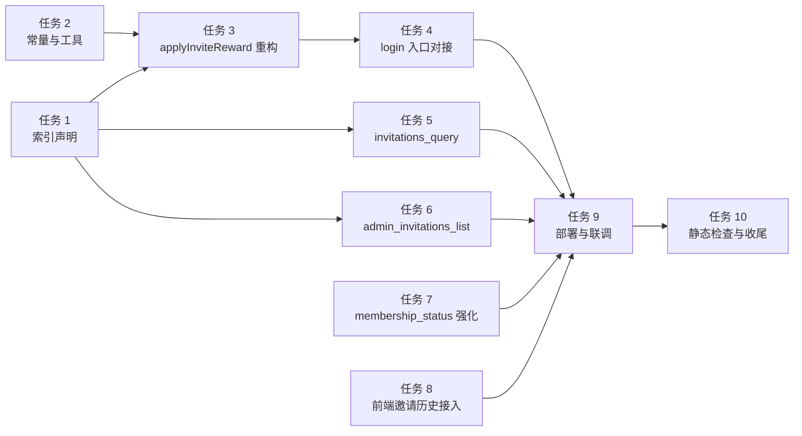

# 邀请好友机制后端实施计划（invite_reward_backend）

> 配套需求：`specs/invite_reward_backend/requirements.md`
> 配套设计：`specs/invite_reward_backend/design.md`
>
> 任务粒度：每条任务可独立提交、独立部署。先索引、再核心改造、再新接口、最后联调。

---

## Implementation Plan

- [x] 1. 准备 `member_invitations` 集合与索引声明
  - 在 `cloudfunctions/setup_indexes/index.js` 中增加 `member_invitations` 集合的 `ensure` 创建逻辑【完成】
  - 在该文件的索引声明里追加 3 个索引【完成】：
    - `idx_invitedUserId_unique`（unique，键 `invitedUserId` ASC）
    - `idx_inviter_createdAt`（非 unique，复合 `inviterUserId` ASC + `createdAt` DESC）
    - `idx_createdAt_desc`（非 unique，键 `createdAt` DESC）
  - 复核 `users.idx_inviteCode_unique` 已声明（保持现状）【完成】
  - 部署 `setup_indexes` + 通过 cloudbase MCP `writeNoSqlDatabaseStructure` 快速创建集合与索引（现场 `CLOUDBASE_ACCESS_TOKEN` 不可用时的兜底路径）【完成】
  - _Requirement: 5.2、5.3、5.4_

- [x] 2. 抽取邀请奖励常量与工具函数
  - 在 `cloudfunctions/login/index.js` 中保持 `INVITE_REWARD_EVERY = 2`、`INVITE_REWARD_DAYS = 7`、`ONE_DAY_MS` 不变【完成】
  - 新增 `isDuplicateKeyError(e)`：通过 `e.errCode === -502002 / 11000` 或 `String(e.message).includes('dup key')` 判定唯一索引冲突【完成】
  - 新增 `buildInvitationDoc(...)`：把“邀请记录初始字段”集中构造，便于阅读和测试【完成】
  - 新增 `INVITATIONS_COLLECTION = 'member_invitations'` 常量，隔离于设计师工单 `invitations` 集合【完成】
  - _Requirement: 6.1、6.2_

- [x] 3. 重构 `applyInviteReward` 主流程【完成】
  - 函数签名改为 `applyInviteReward(db, inviteCode, invitedOpenid, invitedUserId, invitedSnapshot, now)`，新增 `invitedSnapshot = { nickname, avatarUrl }`
  - 步骤 1：归一化 `inviteCode`、查 `users` 找邀请人，处理 `INVITE_CODE_NOT_FOUND` / `INVITE_SELF_FORBIDDEN`
  - 步骤 2：先 `db.collection('member_invitations').add(...)` 写记录，唯一索引冲突 → 返回 `INVITE_ALREADY_BOUND`
  - 步骤 3：用 `db.runTransaction` 重新读邀请人 → 计算 `newCount` / `shouldGrant` → 更新邀请人字段（含 `inviteStats.lastRewardCount`、可选的 `vipExpireAt` / `galleryTrialExpireAt` / `vipLevel`）→ 同时回写 `member_invitations` 记录的 `rewardGranted` / `rewardDays` / `rewardSnapshot`
  - 步骤 4：事务外 `users.doc(invitedUserId).update` 写 `invitedBy` / `invitedByUserId` / `inviteCodeUsed` / `invitedAt`
  - 异常分支：事务失败时把 `errorCode` / `errorMessage` 写回该 `member_invitations` 记录，便于运营排查
  - 等级保护逻辑：仅在 `inviter.vipLevel === 'premium' && beforeVipExpireAt > now` 时保留 `premium`，否则强制 `normal`
  - _Requirement: 1.1、1.2、1.3、1.4、1.5、2.1、2.2、2.3、2.4、2.5、6.1_

- [x] 4. `login` 入口对接重构后的 `applyInviteReward`【完成】
  - 在新用户创建分支调用时同时传入 `invitedSnapshot = { nickname, avatarUrl }`
  - 把返回值规范成 `{ applied, code, rewardDays, inviterId, message }` 并放入 `inviteReward` 字段
  - 保证邀请奖励失败 → `login` 仍返回 `success: true`，仅 `inviteReward.code` 体现失败
  - 服务端日志统一加前缀 `[login][invite]`
  - _Requirement: 2.5、6.1、6.2、6.3、6.4_

- [x] 5. 新建云函数 `invitations_query`【完成 · 部署后调用返回 UNAUTHORIZED 符合验收 3.4】
  - 创建目录 `cloudfunctions/invitations_query/`：`index.js` + `package.json`（依赖 `wx-server-sdk`）
  - 实现 `action=listMine`：查 `member_invitations.where({ inviterOpenid })`，按 `createdAt` 倒序，支持 `pageSize`（默认 20，最大 50） + `lastId` 游标分页
  - 字段脱敏：返回项不包含 `invitedOpenid` 与其他敏感字段
  - 未登录返回 `UNAUTHORIZED`，未知 `action` 返回 `INVALID_PARAMS`
  - 服务端日志统一前缀 `[invitations_query]`
  - 部署到 `cloud1-5gb9c5u2c58ad6d7`
  - _Requirement: 3.1、3.2、3.3、3.4、3.5、6.2、6.4_

- [x] 6. 新建云函数 `admin_invitations_list`【完成 · 部署后调用返回 UNAUTHORIZED（高位映射后）符合验收 4.4 / 6.2】
  - 创建目录 `cloudfunctions/admin_invitations_list/`：`index.js` + `package.json` + `admin_auth.js`（从 `admin_users_list/admin_auth.js` 复制）
  - 入口先调 `requireAdmin(db, _)`，失败返回 `FORBIDDEN`
  - 支持过滤：`inviterKeyword`、`invitedKeyword`、`startAt`、`endAt`、`rewardGranted`
  - 关键词查询：先在 `users` 中按昵称 / 手机号 / 邀请码模糊匹配出 `userId` 列表，再用 `_.in()` 查 `member_invitations.inviterUserId / invitedUserId`
  - 分页：`pageNum` 默认 1，`pageSize` 默认 20、最大 100
  - 关联 `users` 摘要：批量 `where({ _id: _.in([...]) })` 拉回 inviter / invited 的 `nickname`、`phoneNumber`、`avatarUrl`、`inviteCode`，避免 N+1
  - 返回 `{ total, pageNum, pageSize, list }`
  - 服务端日志统一前缀 `[admin_invitations_list]`
  - 部署到 `cloud1-5gb9c5u2c58ad6d7`
  - _Requirement: 4.1、4.2、4.3、4.4、4.5、6.2、6.4_

- [x] 7. 强化 `membership_status` 邀请码生成日志【完成】
  - 现有重试逻辑保留不动
  - 在唯一索引冲突分支补 `[membership_status][inviteCode]` 前缀日志，便于排障
  - 不改变接口契约，无需重写
  - _Requirement: 5.1_

- [x] 8. 前端「邀请历史」页接入 `invitations_query`【完成】
  - 修改 `pages/profile/membership/invite-history/invite-history.js`
  - `loadAll` 内部新增 `wx.cloud.callFunction({ name: 'invitations_query', data: { action: 'listMine' } })`
  - 把返回值映射到 `records`（含昵称、头像、时间、是否发奖、奖励天数）
  - 删除原第 50–53 行的 `// TODO: D 系列需求实施后…` 占位注释
  - 兼容失败：失败时 `records = []` 不抛错，并 `console.warn('[invite-history]')`
  - _Requirement: 3.1、3.2、3.5_

- [x] 9. 部署、联调与回归【后端部分完成 · 真机验收待用户执行】
  - 部署顺序：`setup_indexes` → `login` → `membership_status` → `invitations_query` → `admin_invitations_list`
  - 用 `mcp0_queryFunctions` 拉取每个云函数的最新代码摘要，确认与本地一致
  - 在云开发数据库控制台确认 3 个新索引已生效
  - 真机回归：分享 → 全新设备注册 → 检查 `member_invitations` 集合 +1 记录、`inviter.inviteStats.invitedCount` +1
  - 跨阈值回归：邀请第 2 / 4 / 6 个用户时 `vipExpireAt` 与 `galleryTrialExpireAt` 同步 +7 天，`rewardSnapshot` 字段填充正确
  - 边缘场景回归：自邀、邀请码不存在、被邀请用户已存在 → `inviteReward.code` 各自正确
  - 后台联调（如运营有需要）：构造管理员账号调用 `admin_invitations_list` 验证筛选与分页
  - _Requirement: 全部需求的"验收策略"一节_

- [x] 10. 静态检查与文档收尾【完成】
  - `git diff --check`（空白格式检查）
  - `node --check` 校验所有改动云函数的 `index.js` 语法
  - 更新 `tasks.md` 内每个任务的勾选状态
  - 在 `specs/invite_reward_backend/` 末尾追加 `notes.md`（可选）记录部署时间、回归结论、已知遗留
  - _Requirement: 全部需求_

---

## 任务依赖与执行顺序

> 任务 1 是其余任务的硬依赖（索引未部署 → 唯一性兜底失效）；任务 5/6 可与任务 3/4 并行开发；任务 8 在任务 5 部署后进行。

---

## 风险点跟踪

- **运维 token**：任务 1 部署索引依赖 `process.env.CLOUDBASE_ACCESS_TOKEN`，若环境无此变量 → 索引不会自动建，会回到"调用 setup_indexes 也只是 ensure 集合"的安全降级。任务 9 必须人工到控制台确认 3 个索引已存在。
- **事务上限**：腾讯云开发 `db.runTransaction` 单事务最多 5 个文档操作，本设计仅 2 个，远低于上限；如未来扩展，注意检查。
- **存量邀请数据**：之前 `applyInviteReward` 已运行过的用户，已经有 `invitedBy` 字段，但没有 `member_invitations` 记录。本期不回填；如运营需要，后续单独写一次性运维脚本。
