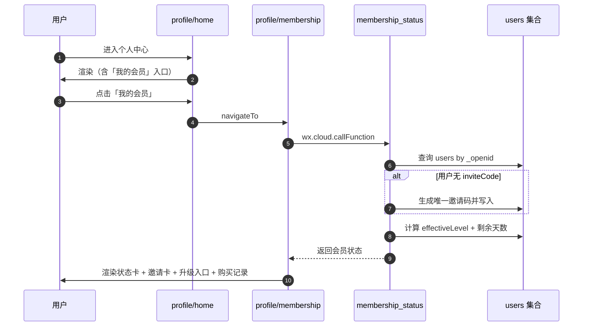
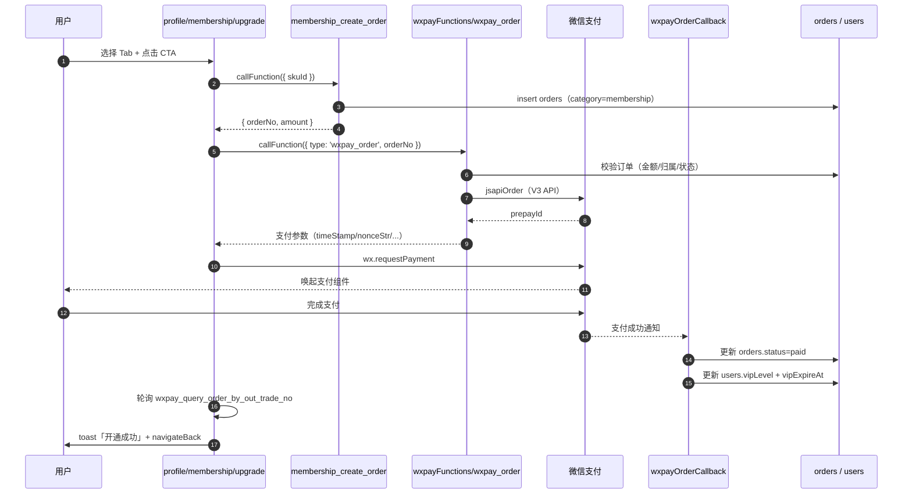
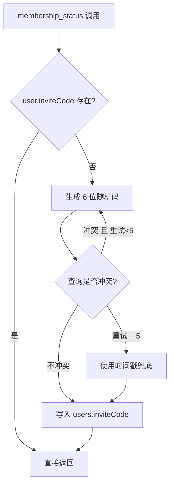

# 会员中心技术设计文档（membership_center）

> 配套需求文档：`specs/membership_center/requirements.md`
>
> 实现范围严格按需求文档「范围声明」，本期仅做：会员中心 UI + 数据模型 + 状态查询 + 微信支付接入；不实现邀请发放、老用户迁移、报告署名、灵感图分级、课程双向赋权等业务逻辑。

---

## 1. 架构设计

### 1.1 整体架构

```mermaid
graph TB
  subgraph Frontend["小程序前端"]
    P1["pages/profile/home/home<br/>新增「我的会员」入口"]
    P2["pages/profile/membership/membership<br/>会员中心首页"]
    P3["pages/profile/membership/upgrade/upgrade<br/>会员开通独立页"]
  end

  subgraph CFExisting["现有云函数"]
    CF1["wxpayFunctions/wxpay_order<br/>(微信支付下单)"]
    CF2["wxpayFunctions/wxpay_query_order_by_out_trade_no<br/>(订单状态查询)"]
    CF3["wxpayOrderCallback<br/>(支付回调，本期需扩展 membership 分支)"]
  end

  subgraph CFNew["新增云函数"]
    CFN1["membership_status<br/>(查询会员状态/生成邀请码)"]
    CFN2["membership_create_order<br/>(创建会员订单 SKU 防篡改)"]
  end

  subgraph DB["云数据库"]
    DB1["users<br/>(扩展 7 字段)"]
    DB2["orders<br/>(category=membership)"]
  end

  P1 --> P2
  P2 --> P3
  P2 --> CFN1
  P3 --> CFN1
  P3 --> CFN2
  CFN2 --> CF1
  P3 -. wx.requestPayment .-> CF1
  CF1 -.支付完成.-> CF3
  CF3 --> DB1
  CF3 --> DB2
  CFN1 --> DB1
  CFN2 --> DB2
```

### 1.2 技术栈

| 层级 | 技术 | 说明 |
|---|---|---|
| 前端框架 | 微信小程序原生 + glass-easel | 与项目一致 |
| 全局样式 | 复用 `app.wxss` Apple 风 design tokens | 不引入第三方 UI 库 |
| 云函数 | Node.js 18 + wx-server-sdk | 与项目一致 |
| 数据库 | 云开发数据库（MongoDB） | 复用 `users`、`orders` 集合 |
| 支付 | 复用现有 `wxpayFunctions` 微信支付 V3 | 不改造支付下单流程 |
| 状态获取 | `cloud.getWXContext().OPENID` | 与项目一致 |

### 1.3 设计原则

1. **复用 > 新建**：支付流程完全复用现有 `wxpayFunctions` + `wxpayOrderCallback`，仅增加 `category=membership` 分支
2. **价格防篡改**：会员价格硬编码在云函数 SKU 表中，前端只能传 `skuId`，不能传金额
3. **续费叠加**：续费时 `vipExpireAt = max(now, vipExpireAt) + 365 天`，不覆盖剩余天数
4. **降级而非升级**：免费用户购买高级会员时，跳过普通会员档位
5. **幂等性**：支付回调可能多次触发，会员激活逻辑必须幂等

---

## 2. 前端架构

### 2.1 页面路由

| 路径 | 文件 | 说明 |
|---|---|---|
| `/pages/profile/membership/membership` | `pages/profile/membership/membership.{js,wxml,wxss,json}` | 会员中心首页 |
| `/pages/profile/membership/upgrade/upgrade` | `pages/profile/membership/upgrade/upgrade.{js,wxml,wxss,json}` | 开通独立页 |

需在 `app.json` 的 `pages/profile/` 子包追加：

```json
{
  "root": "pages/profile/",
  "pages": [
    "home/home",
    "...",
    "invitations/invitations",
    "membership/membership",        // 新增
    "membership/upgrade/upgrade"    // 新增
  ]
}
```

### 2.2 页面结构与数据流

#### 2.2.1 个人中心入口（修改）

`pages/profile/home/home.wxml` 在 `cells.inline` 内、`订单` cell **之上**插入：

```xml
<view class="cell" bindtap="go" data-url="/pages/profile/membership/membership" hover-class="cell-hover">
  <text>我的会员</text>
  <text class="arrow">〉</text>
</view>
```

样式完全复用现有 `.cell` 类，无需修改 `home.wxss`。

#### 2.2.2 会员中心首页

```
membership.wxml 区块结构
├─ <navigation-bar title="我的会员" />
├─ 状态卡片 .status-card（4 种身份分支：免费/普通/高级/试用中）
├─ 邀请卡片 .invite-card（邀请码 + 进度条 + 按钮）
├─ 升级入口 .upgrade-entry（4 种身份分支：开通/升级/续费/续费简版）
└─ 购买记录 .history-card（仅当 hasMembershipOrders=true 时渲染）
```

页面数据结构：

```javascript
data: {
  isLoggedIn: false,
  user: { name: '', avatar: '' },
  membership: {
    effectiveLevel: 'free',      // 'free' | 'normal' | 'premium'
    vipLevel: null,
    vipExpireAt: null,
    remainingDays: 0,
    toolkitPerpetual: false,
    inviteCode: '',
    inviteStats: { invitedCount: 0, trialDaysGranted: 0 }
  },
  history: [],                   // 最近 3 条会员订单
  hasMoreHistory: false
}
```

#### 2.2.3 会员开通独立页

```
upgrade.wxml 区块结构
├─ 顶部关闭按钮 .close-btn
├─ 品牌图标占位 .brand-icon
├─ 大标题 + 副标题
├─ Tab 切换器 .tab-switch（普通/高级）
├─ 价格强调 .price-text
├─ 权益对比表 .benefit-table（白卡 + 7 行）
├─ CTA 按钮 .cta-btn
└─ 协议说明 .agreement-text
```

页面数据结构：

```javascript
data: {
  membership: { /* 同首页 */ },
  activeTab: 'normal',           // 'normal' | 'premium'
  skuMap: {
    normal:  { skuId: 'vip_normal_year',  price: '¥69 / 年',  amount: 69,  unit: '年' },
    premium: { skuId: 'vip_premium_year', price: '¥399 / 年', amount: 399, unit: '年' }
  },
  benefits: [
    { name: '计算器免费版',   free: true,  normal: true,  premium: true  },
    { name: '计算器 Pro UI',  free: false, normal: true,  premium: true  },
    { name: '工具包资料下载', free: false, normal: true,  premium: true  },
    { name: 'PDF 报告导出',   free: false, normal: true,  premium: true  },
    { name: '报告自定义署名', free: false, normal: true,  premium: true  },
    { name: '灵感图库下载',   free: false, normal: false, premium: true  },
    { name: '课程畅看',       free: false, normal: false, premium: true  }
  ],
  isPaying: false                // 防止重复点击 CTA
}
```

### 2.3 前端工具库

**新增** `utils/membership.js`：

```javascript
// 计算 effectiveLevel（与云函数逻辑一致，用于离线展示与防御）
function getEffectiveLevel(vipLevel, vipExpireAt) {
  if (!vipExpireAt || vipExpireAt < Date.now()) return 'free'
  if (vipLevel === 'premium') return 'premium'
  if (vipLevel === 'normal') return 'normal'
  return 'free'
}

// 计算剩余天数
function getRemainingDays(vipExpireAt) {
  if (!vipExpireAt) return 0
  const diff = vipExpireAt - Date.now()
  return diff <= 0 ? 0 : Math.ceil(diff / (24 * 3600 * 1000))
}

// 调用 membership_status 云函数获取最新状态
async function fetchMembershipStatus() { /* ... */ }

// 推荐默认 Tab
function getRecommendedTab(effectiveLevel) {
  if (effectiveLevel === 'normal') return 'premium'  // 已是普通会员，推荐升级
  return 'normal'                                     // 默认推普通会员
}

module.exports = { getEffectiveLevel, getRemainingDays, fetchMembershipStatus, getRecommendedTab }
```

---

## 3. 数据模型设计

### 3.1 users 集合扩展

| 字段 | 类型 | 默认值 | 说明 | 写入时机 |
|---|---|---|---|---|
| `vipLevel` | string \| null | `null` | `'normal'` / `'premium'` / `null` | 支付回调激活时 |
| `vipExpireAt` | number \| null | `null` | 到期时间戳（毫秒） | 支付回调激活时 |
| `vipUpdatedAt` | number \| null | `null` | 最近一次会员状态变更时间戳 | 支付回调激活时 |
| `toolkitPerpetual` | boolean | `false` | 工具包永久权益（本期仅 UI 读取） | 后续 spec 实现 |
| `signature` | string | `''` | 报告自定义署名（本期预埋） | 后续 spec 实现 |
| `inviteCode` | string | `''` | 6 位邀请码（终身唯一） | 首次调 `membership_status` 时生成 |
| `inviteStats` | object | `{ invitedCount: 0, trialDaysGranted: 0 }` | 邀请统计 | 后续 spec 实现 |

**字段语义示例**：

```json
{
  "_id": "user_xxx",
  "_openid": "oXXXX...",
  "nickname": "张先生",
  "phoneNumber": "138****",
  "vipLevel": "normal",
  "vipExpireAt": 1788345600000,
  "vipUpdatedAt": 1756809600000,
  "toolkitPerpetual": false,
  "signature": "",
  "inviteCode": "K7Y2X9",
  "inviteStats": { "invitedCount": 3, "trialDaysGranted": 7 }
}
```

### 3.2 orders 集合复用

复用现有结构，**新增** `category: 'membership'` 类别。文档结构示例：

```json
{
  "_id": "order_xxx",
  "orderNo": "M1762000000000",
  "userId": "oXXXX...",
  "_openid": "oXXXX...",
  "category": "membership",
  "skuId": "vip_normal_year",
  "params": {
    "totalAmount": 69,
    "items": [
      {
        "id": "vip_normal_year",
        "name": "光乙普通会员（1 年）",
        "price": 69,
        "quantity": 1,
        "category": "membership",
        "skuId": "vip_normal_year",
        "duration": 365
      }
    ]
  },
  "status": "pending_payment",
  "paid": false,
  "isDelete": 0,
  "createdAt": 1756809600000,
  "updatedAt": 1756809600000
}
```

订单号前缀约定：`M` 开头（区别于普通订单 `O`、押金订单 `DEP`）。

### 3.3 SKU 定义（云函数硬编码）

```javascript
// cloudfunctions/membership_create_order/sku.js
const MEMBERSHIP_SKUS = {
  vip_normal_year: {
    skuId: 'vip_normal_year',
    name: '光乙普通会员（1 年）',
    price: 69,            // 单位：元
    durationDays: 365,
    targetLevel: 'normal'
  },
  vip_premium_year: {
    skuId: 'vip_premium_year',
    name: '光乙高级会员（1 年）',
    price: 399,
    durationDays: 365,
    targetLevel: 'premium'
  }
}
module.exports = { MEMBERSHIP_SKUS }
```

### 3.4 索引建议

| 集合 | 索引字段 | 类型 | 说明 |
|---|---|---|---|
| `users` | `_openid` | 唯一（已存在） | 主键 |
| `users` | `inviteCode` | 唯一（**本期新增**） | 邀请码唯一性约束 + 后续邀请使用 spec 查询 |
| `orders` | `userId + category + status` | 复合（已存在） | 购买记录查询 |
| `orders` | `orderNo` | 唯一（已存在） | 支付回调匹配 |

> 在 `setup_indexes` 云函数中追加 `users.inviteCode` 唯一索引（稀疏索引，允许 `null`/`''`）。

---

## 4. 云函数设计

### 4.1 membership_status

#### 职责
- 查询当前用户会员状态
- **首次调用时自动生成**邀请码（不存在则生成）
- 后续邀请奖励逻辑不在本期范围

#### 目录结构

```
cloudfunctions/membership_status/
├── index.js
└── package.json
```

#### 接口

**请求**：无 event 参数，从 `cloud.getWXContext()` 获取 OPENID

**响应**：

```javascript
// 成功（已登录）
{
  success: true,
  code: 'OK',
  data: {
    effectiveLevel: 'normal',           // free | normal | premium
    vipLevel: 'normal',
    vipExpireAt: 1788345600000,
    remainingDays: 365,
    toolkitPerpetual: false,
    inviteCode: 'K7Y2X9',
    inviteStats: { invitedCount: 0, trialDaysGranted: 0 },
    isLoggedIn: true
  }
}

// 未登录
{
  success: true,
  code: 'OK',
  data: { effectiveLevel: 'free', isLoggedIn: false }
}
```

#### 核心逻辑

```javascript
exports.main = async (event) => {
  const { OPENID } = cloud.getWXContext()
  if (!OPENID) {
    return { success: true, code: 'OK', data: { effectiveLevel: 'free', isLoggedIn: false } }
  }

  // 1. 查询用户文档
  const userQuery = await db.collection('users').where({ _openid: OPENID }).limit(1).get()
  if (!userQuery.data || userQuery.data.length === 0) {
    return { success: true, code: 'OK', data: { effectiveLevel: 'free', isLoggedIn: true } }
  }
  let user = userQuery.data[0]

  // 2. 邀请码：不存在则生成
  if (!user.inviteCode) {
    const newCode = await generateUniqueInviteCode(db)
    await db.collection('users').doc(user._id).update({ data: { inviteCode: newCode } })
    user.inviteCode = newCode
  }

  // 3. 计算 effectiveLevel
  const now = Date.now()
  let effectiveLevel = 'free'
  const isVipActive = user.vipExpireAt && user.vipExpireAt > now
  if (isVipActive) {
    effectiveLevel = user.vipLevel === 'premium' ? 'premium' : 'normal'
  }

  return {
    success: true,
    code: 'OK',
    data: {
      effectiveLevel,
      vipLevel: user.vipLevel || null,
      vipExpireAt: user.vipExpireAt || null,
      remainingDays: isVipActive ? Math.ceil((user.vipExpireAt - now) / 86400000) : 0,
      toolkitPerpetual: !!user.toolkitPerpetual,
      inviteCode: user.inviteCode,
      inviteStats: user.inviteStats || { invitedCount: 0, trialDaysGranted: 0 },
      isLoggedIn: true
    }
  }
}
```

#### 邀请码生成（核心工具函数）

```javascript
const SAFE_CHARS = 'ABCDEFGHJKLMNPQRSTUVWXYZ23456789' // 去掉易混 O/0/I/1
const CODE_LEN = 6
const MAX_RETRY = 5

function makeRandomCode() {
  let s = ''
  for (let i = 0; i < CODE_LEN; i++) s += SAFE_CHARS[Math.floor(Math.random() * SAFE_CHARS.length)]
  return s
}

async function generateUniqueInviteCode(db) {
  for (let attempt = 0; attempt < MAX_RETRY; attempt++) {
    const code = makeRandomCode()
    const existing = await db.collection('users').where({ inviteCode: code }).limit(1).get()
    if (existing.data.length === 0) return code
  }
  // 极小概率：5 次都冲突，使用时间戳兜底
  return makeRandomCode().slice(0, 4) + Date.now().toString(36).slice(-2).toUpperCase()
}
```

依赖 `users.inviteCode` 唯一索引保证最终一致性。

---

### 4.2 membership_create_order

#### 职责
- 校验 `skuId` 合法性
- 从 SKU 表读取价格（防止前端篡改）
- 创建 `orders` 文档（`category=membership`）
- 返回 `orderNo` 供前端调用 `wxpayFunctions.wxpay_order` 发起支付

#### 接口

**请求**：

```javascript
{ skuId: 'vip_normal_year' }   // 必填
```

**响应**：

```javascript
// 成功
{
  success: true,
  code: 'OK',
  data: { orderNo: 'M1762000000000', amount: 69, skuName: '光乙普通会员（1 年）' }
}

// 失败
{ success: false, code: 'INVALID_SKU' | 'UNAUTHORIZED' | 'SERVER_ERROR' }
```

#### 核心逻辑

```javascript
const { MEMBERSHIP_SKUS } = require('./sku')

exports.main = async (event) => {
  const { OPENID } = cloud.getWXContext()
  if (!OPENID) return { success: false, code: 'UNAUTHORIZED', errorMessage: '未登录' }

  const { skuId } = event
  const sku = MEMBERSHIP_SKUS[skuId]
  if (!sku) return { success: false, code: 'INVALID_SKU', errorMessage: 'SKU 不存在' }

  const orderNo = `M${Date.now()}${Math.floor(Math.random() * 1000).toString().padStart(3, '0')}`
  const now = Date.now()

  const orderDoc = {
    orderNo,
    userId: OPENID,
    _openid: OPENID,
    category: 'membership',
    skuId: sku.skuId,
    params: {
      totalAmount: sku.price,
      items: [{
        id: sku.skuId,
        name: sku.name,
        price: sku.price,
        quantity: 1,
        category: 'membership',
        skuId: sku.skuId,
        duration: sku.durationDays
      }]
    },
    status: 'pending_payment',
    paid: false,
    isDelete: 0,
    createdAt: now,
    updatedAt: now
  }

  await db.collection('orders').add({ data: orderDoc })

  return { success: true, code: 'OK', data: { orderNo, amount: sku.price, skuName: sku.name } }
}
```

---

### 4.3 wxpayOrderCallback 改造

**改造点**：在现有支付回调流程中，新增 `category=membership` 分支处理会员激活。

#### 改造位置

在 `processPaymentNotification` 函数的"判断订单类型"分支（押金分支之后），新增 membership 分支：

```javascript
// 现有代码：押金分支
if (orderType === 'deposit' || outTradeNo.startsWith('DEP')) {
  return await processDepositPayment(order, payInfo)
}

// 【新增】会员订单分支
if (order.category === 'membership' || outTradeNo.startsWith('M')) {
  return await processMembershipPayment(order, {
    transactionId, successTime, amount, payer, paymentData
  })
}

// 现有代码：普通订单（更新订单状态、销量等）
```

#### 新增函数 `processMembershipPayment`

```javascript
async function processMembershipPayment(order, payInfo) {
  const { transactionId, successTime, amount, payer, paymentData } = payInfo
  const now = successTime ? new Date(successTime) : new Date()
  const nowMs = now.getTime()

  // 1. 幂等性检查
  if (order.paid === true && order.transactionId === transactionId) {
    console.log('[membership] 订单已支付且 transactionId 一致，跳过')
    return { skipped: true }
  }

  // 2. 更新订单状态
  await db.collection('orders').doc(order._id).update({
    data: {
      status: 'paid',
      paid: true,
      paidAt: now,
      transactionId,
      paymentAmount: amount?.total || null,
      payerOpenid: payer?.openid || null,
      updatedAt: now,
      callbackId: paymentData?.id,
      callbackSource: 'wxpay_v3_callback'
    }
  })

  // 3. 解析 SKU 与时长
  const skuId = order.skuId || order.params?.items?.[0]?.skuId
  const durationDays = order.params?.items?.[0]?.duration || 365
  const targetLevel = skuId === 'vip_premium_year' ? 'premium' : 'normal'

  // 4. 计算新到期日（续费叠加：从 max(now, vipExpireAt) 开始 +durationDays）
  const userQuery = await db.collection('users').where({ _openid: order._openid }).limit(1).get()
  if (!userQuery.data || userQuery.data.length === 0) {
    console.error('[membership] 用户不存在:', order._openid)
    return { error: 'user not found' }
  }
  const user = userQuery.data[0]
  const baseTime = (user.vipExpireAt && user.vipExpireAt > nowMs) ? user.vipExpireAt : nowMs
  const newExpireAt = baseTime + durationDays * 86400000

  // 5. 写入会员状态
  await db.collection('users').doc(user._id).update({
    data: {
      vipLevel: targetLevel,
      vipExpireAt: newExpireAt,
      vipUpdatedAt: nowMs
    }
  })

  console.log('[membership] ✅ 会员激活成功:', { userId: user._id, level: targetLevel, expireAt: newExpireAt })
  return { success: true, orderNo: order.orderNo, type: 'membership', vipLevel: targetLevel, vipExpireAt: newExpireAt }
}
```

> 注：本期不处理"普通会员升级到高级"这种**降档/升档**的场景（用户依次买两次会员是 `normal` 接 `premium` 还是替换？规则需独立讨论）。本期采用最简单的策略：**SKU 决定 vipLevel，覆盖原值**；后续 spec 再细化升级规则。

---

## 5. 业务流程图

### 5.1 用户进入会员中心



### 5.2 用户购买会员



### 5.3 邀请码生成



---

## 6. 状态机

### 6.1 会员状态

```
┌─────┐  支付普通  ┌──────┐  到期  ┌─────┐
│free │ ────────→ │normal│ ─────→ │free │
└─────┘            └──────┘        └─────┘
   │                  │ 续费/购高级
   │                  ▼
   │ 支付高级    ┌───────┐  到期  ┌─────┐
   └──────────→ │premium│ ─────→ │free │
                └───────┘        └─────┘
```

判定规则（云函数内）：

```
isVipActive = vipExpireAt > Date.now()
effectiveLevel:
  not isVipActive            → 'free'
  vipLevel === 'premium'     → 'premium'
  vipLevel === 'normal'      → 'normal'
  else                       → 'free'
```

### 6.2 订单状态（沿用现有）

```
pending_payment ──支付成功──→ paid ──退款──→ refunded
       │                       │
       └─30 分钟超时─→ closed   └─对账完成──→ completed
```

---

## 7. 安全设计

### 7.1 价格防篡改

- 前端**不传金额**，仅传 `skuId`
- `membership_create_order` 从硬编码 SKU 表读取价格写入订单
- `wxpayFunctions/wxpay_order` 从订单读取金额（已有逻辑）
- 任何前端篡改 `params.totalAmount` 也会在支付下单时被云函数覆盖

### 7.2 权限控制矩阵

| 云函数 | 未登录 | 已登录 | 说明 |
|---|---|---|---|
| `membership_status` | ✅ 返回 free | ✅ 返回真实状态 | 不抛错 |
| `membership_create_order` | ❌ UNAUTHORIZED | ✅ 创建订单 | 必须登录 |
| `wxpayFunctions.wxpay_order` | ❌ | ✅（且订单归属本人） | 已有逻辑 |
| `wxpayOrderCallback` | N/A | N/A | 微信服务器调用，非用户调用 |

### 7.3 幂等性

- `wxpayOrderCallback` 已有幂等逻辑：`order.paid === true && order.transactionId === transactionId` 时跳过
- `processMembershipPayment` 在该幂等检查通过后执行；同一订单的会员激活也只会执行一次

### 7.4 邀请码冲突

- 唯一索引 `users.inviteCode` 兜底
- 应用层重试 5 次 + 时间戳兜底
- 实际冲突概率：32^6 ≈ 10 亿种组合，按 10 万用户计算冲突率 < 0.001%

### 7.5 续费叠加防误覆盖

- 计算公式：`newExpireAt = max(now, vipExpireAt) + durationDays`
- 防止用户连续两次购买导致剩余天数被覆盖

---

## 8. 错误码定义

| 错误码 | 含义 |
|---|---|
| `OK` | 成功 |
| `UNAUTHORIZED` | 未登录或登录失效 |
| `INVALID_SKU` | skuId 不在 SKU 表内 |
| `INVALID_PARAMS` | 参数错误 |
| `ORDER_NOT_FOUND` | 订单不存在 |
| `ORDER_PAID` | 订单已支付（重复支付） |
| `ORDER_CLOSED` | 订单已关闭 |
| `PAYMENT_FAILED` | 微信支付下单失败（详见 detail） |
| `SERVER_ERROR` | 服务器错误 |

---

## 9. 测试策略

### 9.1 单元测试（云函数）

| 用例 | 输入 | 期望输出 |
|---|---|---|
| `membership_status` 未登录 | 空 OPENID | `effectiveLevel='free', isLoggedIn=false` |
| `membership_status` 免费用户 | 已登录无 vip 字段 | `effectiveLevel='free'` 且生成 `inviteCode` |
| `membership_status` 普通会员有效期内 | `vipLevel=normal, vipExpireAt=未来` | `effectiveLevel='normal'` |
| `membership_status` 会员过期 | `vipLevel=premium, vipExpireAt=过去` | `effectiveLevel='free'` |
| `membership_create_order` 合法 SKU | `skuId='vip_normal_year'` | 返回 `orderNo`，DB 中订单 `amount=69` |
| `membership_create_order` 非法 SKU | `skuId='hack_free_year'` | `INVALID_SKU` |
| `membership_create_order` 未登录 | OPENID 空 | `UNAUTHORIZED` |
| `processMembershipPayment` 首次激活 | 免费用户 + 普通订单回调 | `vipLevel='normal'` + `vipExpireAt=now+365d` |
| `processMembershipPayment` 续费叠加 | 普通会员剩 30 天 + 普通订单回调 | `vipExpireAt = vipExpireAt + 365d`（不丢 30 天） |
| `processMembershipPayment` 重复回调 | 同一订单第二次回调 | 跳过，不再叠加 |
| `generateUniqueInviteCode` 重试 | mock 4 次冲突 | 第 5 次成功 |

### 9.2 端到端测试（手工）

| 场景 | 步骤 | 验证点 |
|---|---|---|
| 免费用户首次进入会员中心 | 登录 → 个人中心 → 我的会员 | 状态卡显示「普通用户」、邀请码已生成 |
| 免费用户开通普通会员 | 会员中心 → 升级入口 → 选「普通」→ 支付 | 支付成功后会员中心立即显示「普通会员 · 剩 365 天」 |
| 普通会员升级到高级 | 会员中心 → 升级入口 → 选「高级」→ 支付 | `vipLevel` 升为 `premium`，到期日叠加 |
| Tab 切换 | 开通页 Tab 在两档间切换 | 价格、对比表、CTA 文案同步变化 |
| 已是高级会员 | 进入会员中心 | 不展示开通入口卡片，展示「续费」简版 |
| 工具包用户 | `toolkitPerpetual=true` | 状态卡副标显示「含工具包永久权益」 |

### 9.3 兼容性测试

- 现有 `wxpayOrderCallback` 处理 **押金 / 普通订单** 不应受影响（回归测试）
- `pages/profile/home/home` 的其他 cell（订单、邀请、购物车等）样式不变

---

## 10. 与现有系统集成

### 10.1 复用清单

| 系统 | 复用方式 |
|---|---|
| `wxpayFunctions.wxpay_order` | 不修改，按现有协议调用 |
| `wxpayFunctions.wxpay_query_order_by_out_trade_no` | 不修改，前端轮询使用 |
| `wxpayOrderCallback` | **新增 membership 分支**，不破坏押金/普通订单逻辑 |
| `app.wxss` design tokens | 直接复用 `apple-card`、`apple-button`、`title-medium` 等类 |
| `pages/profile/home/home` 的 `.cell` 样式 | 直接复用 |

### 10.2 不影响项

- `course_purchase_check` / `toolkit_purchase_check` 不变（后续 spec 才会改造为基于会员等级判定）
- 现有商城商品、课程、押金等支付流程完全不受影响
- 个人中心其他 cell（订单、邀请、购物车等）UI 不动

---

## 11. 部署配置

### 11.1 新增云函数 package.json

```json
{
  "name": "membership_status",
  "version": "1.0.0",
  "main": "index.js",
  "dependencies": {
    "wx-server-sdk": "~2.6.3"
  }
}
```

`membership_create_order` 同样依赖 `wx-server-sdk`。

### 11.2 云函数配置

| 云函数 | 超时 | 内存 | 说明 |
|---|---|---|---|
| `membership_status` | 5s | 128MB | 简单查询 |
| `membership_create_order` | 5s | 128MB | 简单查询 + 写入 |

### 11.3 数据库初始化

需在初始化脚本（或手动执行）：

```javascript
// 添加 users.inviteCode 唯一索引（稀疏，允许 null/'' 共存）
db.collection('users').createIndex(
  { inviteCode: 1 },
  { unique: true, sparse: true }
)
```

可在 `setup_indexes` 云函数中追加。

---

## 12. 回滚方案

| 风险 | 回滚动作 |
|---|---|
| 会员激活逻辑出错 | 在 `wxpayOrderCallback` 中将 `processMembershipPayment` 调用注释掉，恢复回退到现有"普通订单"分支（订单仍 `status=paid`，仅会员状态不写入） |
| 数据库字段误写 | `vipLevel`、`vipExpireAt` 字段可手动批量重置；`inviteCode` 字段唯一索引可改为非唯一 |
| 个人中心入口体验问题 | 移除 `pages/profile/home/home.wxml` 中新增的一行 cell |
| 开通页支付失败 | 用户可重新点击 CTA；订单 30 分钟超时自动关闭，不影响用户余额 |

---

## 13. 开放问题（design 阶段记录，不影响 P0）

> 以下问题不影响本期 P0 实现，本期 design 仅采用最简单的兜底策略，待后续 spec 细化：

1. **降档处理**：用户已是 premium 时购买 normal 会发生什么？  
   **本期策略**：覆盖 `vipLevel = 'normal'`（用户极不可能这么操作；前端开通页对 premium 用户不展示普通会员档；属于异常场景）
2. **会员到期通知**：到期前 7 天/3 天/当日是否需要订阅消息提醒？  
   **本期策略**：不实现（需独立 spec）
3. **退款规则**：会员订单是否支持退款？  
   **本期策略**：不实现（参考 wxpay_refund 已有机制，需业务规则确认）

---

## 14. 已知 Caveats（实施阶段补充）

### 14.1 CloudBase NoSQL `$unset` 操作符不生效

**现象**：通过 MCP 或 wx-server-sdk 调用 `db.collection().doc().update({ data: { field: _.remove() } })` 或直接传入 MongoDB `$unset` 操作符时，腾讯云 CloudBase NoSQL 数据库返回 `modifiedCount: 1`（看似成功），但目标字段**实际不会被删除**。

**影响范围**：会员重置脚本、押金退款脚本、所有需要"删除字段"语义的运营操作。

**绕过方案**：
- 优先使用 `$set` 把字段写为兜底值（如 `vipLevel: "free"`、`vipExpireAt: 0`、`""`、`null`），让业务代码按"无效值"处理。
- 若必须删除字段，需要从 wx-server-sdk 调用 `command.remove()` 操作符，或通过云开发控制台手动编辑文档 JSON。

**对当前实现的影响**：`processMembershipPayment` 内的续费叠加公式 `baseTime = (user.vipExpireAt && user.vipExpireAt > nowMs) ? user.vipExpireAt : nowMs` 设计正确，但运营脚本若依赖 `$unset` 重置 vipExpireAt 不生效，会让"首次激活"测试场景误入"续费叠加"分支。运营文档应记录此 caveat。

### 14.2 `wxpayOrderCallback` 的会员分支必须优先于外层幂等

**背景**：前端 `pollOrderPaid` 通过 `wxpay_query_order_by_out_trade_no` 主动查询订单状态时，该云函数会**直接将 orders 集合中的订单写为 `paid: true` + `transactionId`**（标记 `syncSource: "query"`）。如果 `wxpayOrderCallback` 真实回调晚于 query 调用到达，外层幂等检查 `if (order.paid && order.transactionId === transactionId) return { skipped: true }` 会跳过整个回调处理，导致 `processMembershipPayment` 永不执行。

**修复策略**：
- `wxpayOrderCallback/index.js` 中**会员订单分支判断必须放在外层幂等检查之前**。
- `processMembershipPayment` 内部幂等改为基于 `callbackSource === 'wxpay_v3_callback'` 字段判断（query 写入 `syncSource` 不写 `callbackSource`，可作为"是否被回调真实处理过"的可靠标志）。

**潜在影响**：押金分支 `processDepositPayment` 与普通订单更新逻辑也存在相同隐患（前端 `pollOrderPaid` 提前写入会绕过销量更新、`requests` 优先级置位等动作），但用户当前未报告问题，暂不修。后续如需彻底解决，应统一将"分支判断"全部前置，幂等保护下沉到每个 processor 内部。

### 14.3 `wxpayOrderCallback` 必须独立配置 5 个微信支付环境变量

**现象**：`wxpayOrderCallback` 与 `wxpayFunctions` 是两个独立云函数，**不共享环境变量**。如 `wxpayOrderCallback` 缺失 `WX_APIV3_KEY` 等密钥，回调进入后会抛出 `APIv3 密钥未配置，无法解密回调数据`，所有支付分支都无法激活。

**配置清单**（必须从 `wxpayFunctions` 复制 5 个变量到 `wxpayOrderCallback`）：

| 变量名 | 用途 |
|---|---|
| `WX_APIV3_KEY` | 解密微信支付 V3 回调密文 |
| `WX_APPID` | 应用 ID（小程序） |
| `WX_MCHID` | 商户号 |
| `WX_PRIVATE_KEY` | 商户私钥（用于签名） |
| `WX_SERIAL_NO` | 商户证书序列号 |

**部署 checklist**：每次重新部署 `wxpayOrderCallback` 后必须验证环境变量未被覆盖（云函数环境变量在某些 CI/CD 流程中可能被空值覆盖）。

---

## 变更记录

- 2026-05-07 v1：首版技术设计文档
- 2026-05-07 v1.1：实施阶段补充 §14 Caveats（CloudBase `$unset` 不生效、会员分支必须优先于幂等、wxpayOrderCallback 独立环境变量配置清单）
